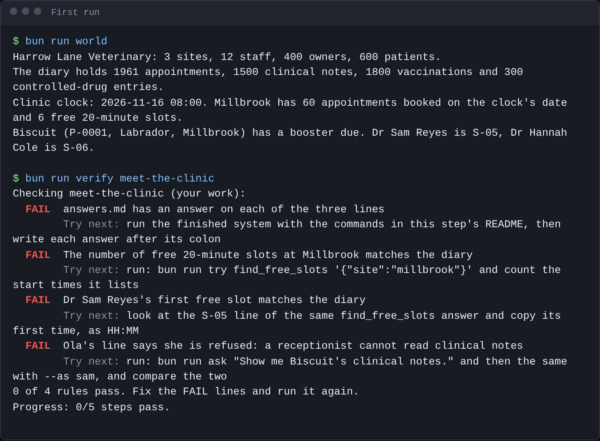

# Start here

You will set up the repo, meet Harrow Lane Veterinary, run the finished server, and see the goal. It takes about 15
minutes and needs no API key.

## Set up

Install [Bun](https://bun.sh), then, in the repo folder:

```bash
bun install
```

Expect: `bun install` ends with no errors.

## Meet the world

Harrow Lane Veterinary is a fictional group of three small-animal clinics: Harrow Lane, Millbrook and Eastgate. Its
practice system (the PIMS) holds the diary, 600 patients, their owners, clinical notes, vaccinations and the
controlled-drugs register. It lives in `world/`: `world/clinic.ts` is the PIMS's API, and the data is a SQLite file
built from a fixed seed, so every learner sees the same diary.

```bash
bun run world
```

Expect: `Harrow Lane Veterinary: 3 sites, 12 staff, 400 owners, 600 patients.` and a line that ends `6 free 20-minute slots.`

The people you will meet: Ola Nowak, receptionist at Millbrook; Dr Sam Reyes, vet at Millbrook; Joon Park, clinical
director. A receptionist books and moves appointments. A vet reads notes for their own site's patients. Only the
clinical director reads the controlled-drugs register. Anything you change, `bun run world reset` puts back.

## Run the finished system and see the goal

The first step, `meet-the-clinic`, has you run the finished server and write down three facts. Its README is
[parts/00-start-here/01-meet-the-clinic/problem/README.md](../parts/00-start-here/01-meet-the-clinic/problem/README.md).
Before you start it, run its check once to see what a first run looks like:

```bash
bun run verify meet-the-clinic
```

Expect: four `FAIL` lines, each with a `Try next:` line. Every step starts failing; the check tells you what to do.



## If you are a product manager

You can do the whole course without writing TypeScript: run each step's solution with
`bun run verify <step-name> solution`, read the diagrams, and do the written steps yourself (`meet-the-clinic`,
`connect-claude`, and later the eval and the handover).

## Using a real model

Copy `.env.example` to `.env`, set `LLM_PROVIDER` to `anthropic`, `openrouter`, `openai` or `ollama`, and fill in
that one key. `bun run models` makes one tiny call per role and prints pass or fail. Checks never need a key.

When a command prints something you do not expect, look it up in [troubleshooting.md](troubleshooting.md).
