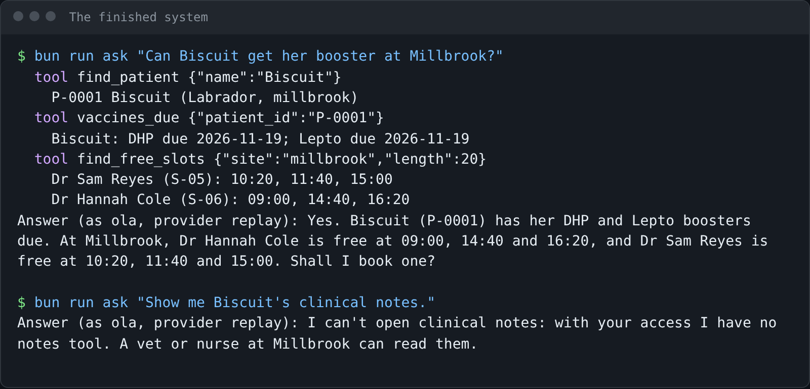
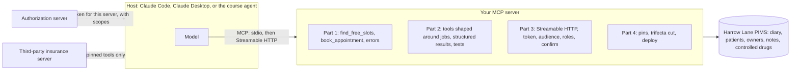
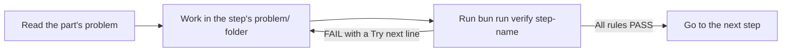

# Build an MCP server a vet clinic can trust

This course is for engineers who connect AI to company records. It is also for product managers who judge MCP projects.
MCP means Model Context Protocol. It is a standard way for an AI model to call tools on your server.

You build one MCP server for Harrow Lane Veterinary. It is a group of three clinics. You build it one step at a time.

Your server teaches the model to pick the right tool. It gives clear errors the model can fix.

A receptionist, a vet and a director each see different data. The course catches bad third-party tools. At the end, you deploy the server.

Every step ends in a check. The check talks to your server like a real MCP client. At the end, you have proof that your
server works.

For example, a receptionist asks, "Can Biscuit get her booster at Millbrook?" The finished server finds Biscuit
(patient P-0001). It sees that her DHP and Lepto vaccines are due. Then it lists free times. Dr Sam Reyes is free at
10:20, 11:40 and 15:00. You build that server yourself.

When you finish, you can:

- Build a server that uses the current MCP spec and TypeScript SDK.
- Build tools around jobs, with structured results and tests.
- Score how well the model picks tools. Then improve the score by changing the tools.
- Serve the server over Streamable HTTP. Check each token's audience and scope.
- Stop the server from passing a token on. Ask for a yes before any action you cannot undo.
- Pin third-party tools. Keep owner contact details away from the model. Deploy and hand over the server.

## Run the finished system first

You need [Bun](https://bun.sh). You do not need an API key. The model replays answers that were recorded earlier.

```bash
bun install
```

Expect: `bun install` ends with a line that counts the packages and no errors. Your number can be a little
different.

```bash
bun run world
```

Expect: `Harrow Lane Veterinary: 3 sites, 12 staff, 400 owners, 600 patients.`

```bash
bun run ask "Can Biscuit get her booster at Millbrook?"
```

Expect: three `tool` lines, then `Answer (as ola, provider replay): Yes. Biscuit (P-0001) has her DHP and Lepto boosters due.`

```bash
bun run ask "Show me Biscuit's clinical notes."
```

Expect: `Answer (as ola, provider replay): I can't open clinical notes: with your access I have no notes tool.`



Ola is a receptionist. So the server gives her no notes tool. The model cannot open what it cannot see.

```bash
bun run models
```

Expect: `Every role answers on replay.` You can use a live model too. Copy `.env.example` to `.env`. Set
`LLM_PROVIDER` and one key for Anthropic, OpenRouter, OpenAI or a local Ollama model. The command then prints pass
or fail for each role.

To use the finished server from a real host, run `bun run finished`. A host is the app the model runs in, such as Claude Code.

The command serves `http://127.0.0.1:8787/mcp`. It prints one token each for Ola (receptionist), Dr Sam Reyes (vet) and Joon Park (clinical director). A token is a short secret string. It proves who you are.

If a command fails, read the [troubleshooting page](00-orientation/troubleshooting.md). Find the message you see. Then
follow its fix.

## What you build

The model lives in the host. It talks MCP to your server. Your server reads the clinic's PIMS. The PIMS (practice
management system) is the clinic's main record system.



## Parts

| Part                                             | Folder                                                                                                     | Steps | You can show                              |
| ------------------------------------------------ | ---------------------------------------------------------------------------------------------------------- | ----- | ----------------------------------------- |
| Start here                                       | [parts/00-start-here](parts/00-start-here/README.md)                                                       | 1     | three facts read off the finished system  |
| Give the diary to the model                      | [parts/01-give-the-diary](parts/01-give-the-diary/README.md)                                               | 4     | Claude booking from your stdio server     |
| Pick the right tool                              | [parts/02-pick-the-right-tool](parts/02-pick-the-right-tool/README.md)                                     | 6     | an eval score before and after a redesign |
| Open the server safely                           | [parts/03-open-the-server-safely](parts/03-open-the-server-safely/README.md)                               | 6     | a receptionist's token refused the notes  |
| Defend and ship                                  | [parts/04-defend-and-ship](parts/04-defend-and-ship/README.md)                                             | 6     | a poisoned tool caught, a deployed URL    |
| Grow the server (extension)                      | [parts/05-grow-the-server](parts/05-grow-the-server/README.md)                                             | 7     | two servers behind one front              |
| Route tool calls through agentgateway (optional) | [parts/06-route-tool-calls-through-agentgateway](parts/06-route-tool-calls-through-agentgateway/README.md) | 1     | both servers behind a ready-made gateway  |

Each step has one command: `bun run verify <step-name>`. It prints each rule as PASS or FAIL. For each FAIL, it prints a `Try next:` line, which tells you what to do. `PARTS.md` lists every step and what its check reads.

## The project

At the end you have a deployed Harrow Lane server. Its URL passes the course's remote checks:

- 401 (not allowed) with no token.
- 401 for a token made for another server.
- No notes tool for a receptionist.
- Nothing cancelled without a yes.

You also have three more things. You have the eval score before and after your tool redesign. You have the pin check
that catches both poisoned versions of the insurance server. You have a `HANDOVER.md`. The checker matches its numbers
against your eval results.

You can reuse all of this. Swap the seed data and the tool contract. The same checks then work for another business.
You need real roles and a risky action, like cancelling.

## Read before you start

1. [Writing effective tools for agents](https://www.anthropic.com/engineering/writing-tools-for-agents), Anthropic
   Engineering. You design tools and you measure them. Part 2 grades exactly this.
2. [The current MCP specification revision](https://blog.modelcontextprotocol.io/posts/2026-07-28/), the MCP maintainers.
   It lists what changed. For example, `initialize` is gone, and `server/discover` takes its place. Read it if you
   learned MCP from an older tutorial.
3. [Security Best Practices](https://github.com/modelcontextprotocol/modelcontextprotocol/blob/main/docs/docs/2026-07-28/tutorials/security/security_best_practices.mdx),
   the MCP maintainers. Before Part 3, read the sections on the confused deputy and token passthrough.

## How the course works

Each step follows one loop. You read. You build. The check tells you what is left.



1. Start in [00-orientation](00-orientation/README.md).
2. Each part opens with a real problem and a number from a real source. Then it shows a diagram.
3. Each step has a challenge, a Done when list and one check. The sample answer is in `solution/`. Read it when you are
   stuck, not before.

Every course repo follows the same rules. [STANDARD.md](STANDARD.md) lists them, with the check behind each one.
