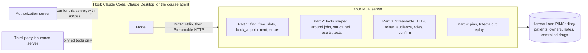

# Build an MCP server a vet clinic can trust

For engineers who connect AI to a company's system of record, and for technical product managers who must judge an
MCP project. You build one MCP server for Harrow Lane Veterinary, a group of three clinics, step by step: tools the
model picks correctly, errors it can fix, a remote server where each role sees only what it should, defences
against poisoned third-party tools, and a deploy. Every step ends in a check that talks to your server as a real MCP
client, so you finish with proof, not a certificate.

You leave able to:

- build a server on the current MCP spec and TypeScript SDK v2, with job-shaped tools, structured results and tests;
- measure tool choice with an eval and raise the score by redesigning the tools;
- serve it over Streamable HTTP as an OAuth resource server: audience and scope checks, no token passthrough,
  a confirmation before anything destructive;
- pin third-party tools, keep owner contact details away from the model, deploy, and hand it over.

## Run the finished system first

You need [Bun](https://bun.sh) and nothing else. No API key: the model replays recorded turns.

```bash
bun install
```

Expect: `bun install` ends with a line such as `29 packages installed` and no errors.

```bash
bun run world
```

Expect: `Harrow Lane Veterinary: 3 sites, 12 staff, 400 owners, 600 patients.`

```bash
bun run ask "Can Biscuit get her booster at Millbrook?"
```

Expect: three `tool` lines, then `Answer (as ola, provider replay): Yes. Biscuit (P-0001) has her DHP and Lepto boosters due.`

```bash
bun run ask "Show me Biscuit's clinical notes."
```

Expect: `Answer (as ola, provider replay): I can't open clinical notes: with your access I have no notes tool.`


```bash
bun run models
```

Expect: `Every role answers on replay.` Set `LLM_PROVIDER` and one key in `.env` (copy `.env.example`) to use
Anthropic, OpenRouter, OpenAI or a local Ollama model instead; the command then prints pass or fail per role.

To use the finished server from a real host, run `bun run finished`. It serves `http://127.0.0.1:8787/mcp` and prints
a token for Ola (receptionist), Dr Sam Reyes (vet) and Joon Park (clinical director).

## What you build



## Parts

| Part                        | Folder                                                                       | Steps | Minutes | You can show                              |
| --------------------------- | ---------------------------------------------------------------------------- | ----- | ------- | ----------------------------------------- |
| Start here                  | [parts/00-start-here](parts/00-start-here/README.md)                         | 1     | 15      | three facts read off the finished system  |
| Give the diary to the model | [parts/01-give-the-diary](parts/01-give-the-diary/README.md)                 | 4     | 50      | Claude booking from your stdio server     |
| Pick the right tool         | [parts/02-pick-the-right-tool](parts/02-pick-the-right-tool/README.md)       | 6     | 65      | an eval score before and after a redesign |
| Open the server safely      | [parts/03-open-the-server-safely](parts/03-open-the-server-safely/README.md) | 6     | 70      | a receptionist's token refused the notes  |
| Defend and ship             | [parts/04-defend-and-ship](parts/04-defend-and-ship/README.md)               | 4     | 55      | a poisoned tool caught, a deployed URL    |
| Grow the server (extension) | [parts/05-grow-the-server](parts/05-grow-the-server/README.md)               | 5     | 95      | two servers behind one front              |

Every step has one command: `bun run verify <step-name>`. It prints each rule as PASS or FAIL, and a `Try next:`
line for each FAIL. `PARTS.md` lists every step and what its check reads. `schedules.toml` maps the parts onto formats,
from one long sitting to a cohort that meets several times.

## The project

A deployed Harrow Lane server whose URL passes the course's remote checks: 401 with no token, 401 for a token minted
for another server, no notes tool for a receptionist, nothing cancelled without a yes. Next to it: the eval score
before and after your tool redesign, the pin check catching both poisoned insurance-server versions, and a
`HANDOVER.md` whose numbers the checker matches against your eval results. Swap the seed data and the tool contract
and the same checks work for another business with real roles and a risky action.

## Read before you start

1. [Writing effective tools for agents](https://www.anthropic.com/engineering/writing-tools-for-agents), Anthropic
   Engineering. Tools are designed and measured; Part 2 grades exactly this.
2. [The current MCP specification revision](https://blog.modelcontextprotocol.io/posts/2026-07-28/), the MCP maintainers. What
   changed: no `initialize`, `server/discover` instead, multi round-trip requests. It resets anyone who
   learned MCP from an older tutorial.
3. [Security Best Practices](https://github.com/modelcontextprotocol/modelcontextprotocol/blob/main/docs/docs/2026-07-28/tutorials/security/security_best_practices.mdx),
   the MCP maintainers. Read the sections on the confused deputy and token passthrough before Part 3.

## How the course works

1. Start in [00-orientation](00-orientation/README.md).
2. Each part opens with a real problem, why it matters with a cited number, and a diagram.
3. Each step has a challenge, a Done when list, and one check. You work in the step's `problem/` folder. The
   sample answer is in `solution/`; read it when you are stuck, not before.

The rules every course repo follows, and the check that enforces each one, are in [STANDARD.md](STANDARD.md).
