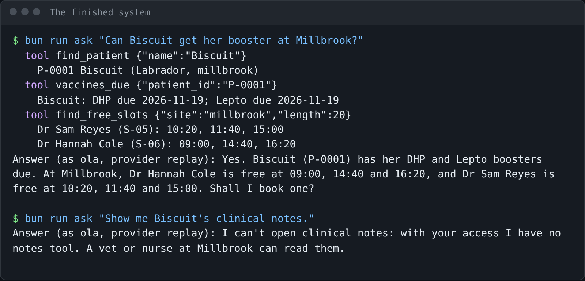
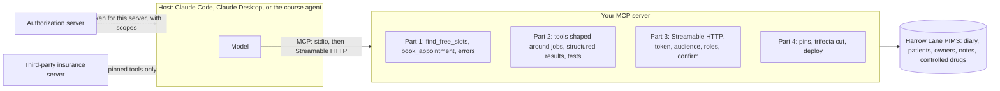

# Build an MCP server a vet clinic can trust

This course is for engineers who connect AI to a company's records. It is also for product managers who must judge
an MCP project. MCP (Model Context Protocol) is a standard way for an AI model to call tools on your server.

You build one MCP server for Harrow Lane Veterinary, a group of three clinics. You build it step by step. The model
picks the right tool. It gets errors it can fix. Each role sees only what it should. Bad third-party tools are
caught. Then you deploy it.

Every step ends in a check. The check talks to your server like a real MCP client. So you finish with proof that
your server works, not a certificate.

For example, a receptionist asks "Can Biscuit get her booster at Millbrook?". The finished server finds Biscuit
(patient P-0001), sees her DHP and Lepto vaccines are due, and lists free times. Dr Sam Reyes is free at 10:20,
11:40 and 15:00. You build that server yourself.

You leave able to:

- build a server on the current MCP spec and TypeScript SDK v2. It has tools shaped around jobs, structured results
  and tests;
- measure how well the model picks tools with an eval (a scored test), then raise the score by redesigning the tools;
- serve it over Streamable HTTP as an OAuth resource server. It checks each token's audience and scope. It never
  passes a token on. It asks for a yes before anything it cannot undo;
- pin third-party tools, keep owner contact details away from the model, deploy, and hand it over.

## Run the finished system first

You need [Bun](https://bun.sh) and nothing else. You need no API key: the model replays answers that were recorded
earlier.

```bash
bun install
```

Expect: `bun install` ends with a line such as `31 packages installed` and no errors. Your number can be a little
different.

```bash
bun run world
```

Expect: `Harrow Lane Veterinary: 3 sites, 12 staff, 400 owners, 600 patients.`

```bash
bun run ask "Can Biscuit get her booster at Millbrook?"
```

Expect: three `tool` lines, then `Answer (as ola, provider replay): Yes. Biscuit (P-0001) has her DHP and Lepto boosters due.`

```bash
bun run ask "Show me Biscuit's clinical notes."
```

Expect: `Answer (as ola, provider replay): I can't open clinical notes: with your access I have no notes tool.`



Ola is a receptionist, so the server gives her no notes tool. The model cannot open what it cannot see.

```bash
bun run models
```

Expect: `Every role answers on replay.` You can use a live model too. Copy `.env.example` to `.env`. Set
`LLM_PROVIDER` and one key for Anthropic, OpenRouter, OpenAI or a local Ollama model. The command then prints pass
or fail for each role.

To use the finished server from a real host, run `bun run finished`. A host is the app the model runs in, such as
Claude Code. The command serves `http://127.0.0.1:8787/mcp`. It prints a token for Ola (receptionist), Dr Sam Reyes
(vet) and Joon Park (clinical director). A token is a short secret string that says who you are.

## What you build

The model lives in the host. It talks MCP to your server, and your server reads the clinic's PIMS. The PIMS
(practice management system) is the clinic's main record system.



## Parts

| Part                                             | Folder                                                                                                     | Steps | Minutes | You can show                              |
| ------------------------------------------------ | ---------------------------------------------------------------------------------------------------------- | ----- | ------- | ----------------------------------------- |
| Start here                                       | [parts/00-start-here](parts/00-start-here/README.md)                                                       | 1     | 15      | three facts read off the finished system  |
| Give the diary to the model                      | [parts/01-give-the-diary](parts/01-give-the-diary/README.md)                                               | 4     | 50      | Claude booking from your stdio server     |
| Pick the right tool                              | [parts/02-pick-the-right-tool](parts/02-pick-the-right-tool/README.md)                                     | 6     | 65      | an eval score before and after a redesign |
| Open the server safely                           | [parts/03-open-the-server-safely](parts/03-open-the-server-safely/README.md)                               | 6     | 70      | a receptionist's token refused the notes  |
| Defend and ship                                  | [parts/04-defend-and-ship](parts/04-defend-and-ship/README.md)                                             | 4     | 55      | a poisoned tool caught, a deployed URL    |
| Grow the server (extension)                      | [parts/05-grow-the-server](parts/05-grow-the-server/README.md)                                             | 5     | 95      | two servers behind one front              |
| Route tool calls through agentgateway (optional) | [parts/06-route-tool-calls-through-agentgateway](parts/06-route-tool-calls-through-agentgateway/README.md) | 1     | 25      | both servers behind a ready-made gateway  |

Every step has one command: `bun run verify <step-name>`. It prints each rule as PASS or FAIL. For each FAIL, it
adds a `Try next:` line that tells you what to do. `PARTS.md` lists every step and what its check reads.
`schedules.toml` fits the parts into different formats. One format is one long sitting. Another is a group that
meets several times.

## The project

At the end you have a deployed Harrow Lane server. Its URL passes the course's remote checks:

- 401 (not allowed) with no token;
- 401 for a token made for another server;
- no notes tool for a receptionist;
- nothing cancelled without a yes.

Next to it you have three more things. You have the eval score before and after your tool redesign. You have the
pin check catching both poisoned versions of the insurance server. You have a `HANDOVER.md`, and the checker matches
its numbers against your eval results.

You can reuse all of this. Swap the seed data and the tool contract, and the same checks work for another business.
It needs real roles and a risky action, like cancelling.

## Read before you start

1. [Writing effective tools for agents](https://www.anthropic.com/engineering/writing-tools-for-agents), Anthropic
   Engineering. You design tools and you measure them. Part 2 grades exactly this.
2. [The current MCP specification revision](https://blog.modelcontextprotocol.io/posts/2026-07-28/), the MCP maintainers.
   It lists what changed: no `initialize`, `server/discover` in its place, and requests that take more than one round
   trip. Read it if you learned MCP from an older tutorial.
3. [Security Best Practices](https://github.com/modelcontextprotocol/modelcontextprotocol/blob/main/docs/docs/2026-07-28/tutorials/security/security_best_practices.mdx),
   the MCP maintainers. Before Part 3, read the sections on the confused deputy and token passthrough.

## How the course works

1. Start in [00-orientation](00-orientation/README.md).
2. Each part opens with a real problem. It says why the problem matters, with a number from a real source. Then it
   shows a diagram.
3. Each step has a challenge, a Done when list, and one check. You work in the step's `problem/` folder. The sample
   answer is in `solution/`. Read it when you are stuck, not before.

Every course repo follows the same rules. [STANDARD.md](STANDARD.md) lists them, with the check behind each one.
