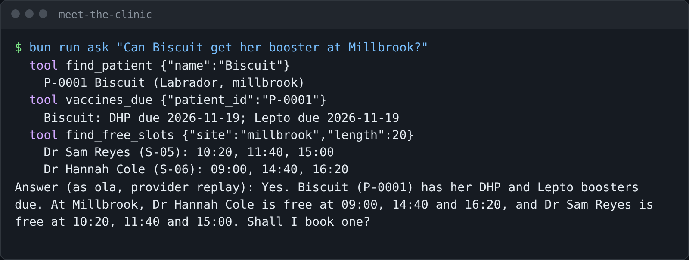

# Meet the clinic

## The problem

Harrow Lane Veterinary has three clinics and twelve staff on one practice system. The front desk wants to ask Claude
"can Biscuit get her booster?", but today they click through five screens. The director wants one promise first:
nobody sees what their role should not see. For example, Ola, the receptionist, must not read clinical notes.

## Watch it done

Before you write anything, the check prints four `FAIL` lines. Real output:

```text
  FAIL  answers.md has an answer on each of the three lines
  FAIL  The number of free 20-minute slots at Millbrook matches the diary
  FAIL  Dr Sam Reyes's first free slot matches the diary
  FAIL  Ola's line says she is refused: a receptionist cannot read clinical notes
0 of 4 rules pass. Fix the FAIL lines and run it again.
```

With the sample answers it ends with `Done. All 4 rules pass.` The finished agent answers like this:



## Your turn

1. Look at the clinic's data.

```bash
bun run world
```

Expect: `Harrow Lane Veterinary: 3 sites, 12 staff, 400 owners, 600 patients.` and three more lines about the diary.

2. Call one tool of the finished server as Ola, the receptionist.

```bash
bun run try find_free_slots '{"site":"millbrook"}'
```

Expect: one line per vet, such as `Dr Sam Reyes (S-05): 10:20, 11:40, 15:00`.

3. Ask for clinical notes as Ola, then as Dr Sam Reyes.

```bash
bun run ask "Show me Biscuit's clinical notes."
bun run ask "Show me Biscuit's clinical notes." --as sam
```

Expect: Ola is told she cannot open clinical notes. Sam gets a `read_notes` call and the notes.

4. Write the three answers in `answers.md` in this folder.

## Do it on your work

Do the same on your own system. Find one thing a person can ask it, one thing it must refuse, and one number you can
read off it. Good looks like three facts you can check against the real system.

## Done when

- `answers.md` has an answer on each of the three lines.
- The number of free 20-minute slots at Millbrook matches the diary.
- Dr Sam Reyes's first free slot matches the diary.
- Ola's line says she is refused: a receptionist cannot read clinical notes.

```bash
bun run verify meet-the-clinic
```

Expect: `Done. All 4 rules pass.` Before that, each `FAIL` line has a `Try next:`.

## Solution

The after state is one `answers.md` file with the three facts. See `solution/answers.md`.

## If you get stuck

- Add `--as sam` to `bun run try` to see the tools of other staff.
- The answers come from the diary, so they are the same on every computer. Different answers? Run `bun run world reset`.
- You need no API key: `bun run ask` replays recorded model turns.

## Go further

Do you know MCP already? Read `world/finished/server.ts` now. It is the server you build in this course.

## Words you will use

- **MCP server**: a program that offers tools to an AI app (the host) in a standard way. Any MCP host can use them.
- **Tool**: one action the model may call. It has a name, a description and a schema for its arguments.
- **Host**: the app the person talks to, such as Claude Code. It runs the model and calls the tools.
- **PIMS**: practice management system, the clinic's main record.
- **Token**: a signed pass that says who is calling and what they may do.
