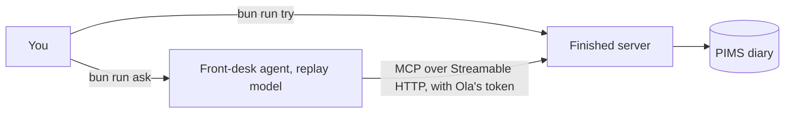

# Start here

## The problem

You are the one engineer at Harrow Lane Veterinary, a group of three small-animal clinics. You have been asked to
"let the team use Claude with the diary and the records, without anyone seeing what they should not". Before you
build, you need to see the clinic's data, the finished server, and what "done" looks like.



## Steps

| Step | Minutes | You produce | The check reads |
|---|---|---|---|
| `meet-the-clinic` | 15 | `answers.md`: three facts read off the finished system | a fresh copy of the diary |

## Walkthrough

```bash
bun run verify meet-the-clinic
```

Expect: `Done. All 4 rules pass.` once `answers.md` holds your three answers.
