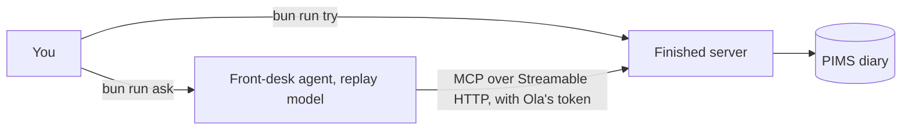

# Start here

## The problem

You are the only engineer at Harrow Lane Veterinary, a group of three clinics for small animals. Your boss asks you
to "let the team use Claude with the diary and the records, without anyone seeing what they should not".

Before you build anything, you need to see three things: the clinic's data, the finished server, and what "done"
looks like. This part shows you all three.

For example, you ask the finished server, as Ola the receptionist, `bun run try find_free_slots '{"site":"millbrook"}'`.
It answers `Dr Sam Reyes (S-05): 10:20, 11:40, 15:00`. Facts like this one go into your `answers.md`.

The diagram shows the two ways you talk to the finished server. `bun run ask` goes through an agent and a model.
`bun run try` calls one tool directly.



## Steps

| Step              | Minutes | You produce                                            | The check reads           |
| ----------------- | ------- | ------------------------------------------------------ | ------------------------- |
| `meet-the-clinic` | 15      | `answers.md`: three facts read off the finished system | a fresh copy of the diary |

## Walkthrough

```bash
bun run verify meet-the-clinic
```

Expect: `Done. All 4 rules pass.` once `answers.md` holds your three answers.

Before you write your answers, the same command prints four `FAIL` lines. Each one has a `Try next:` line that tells
you which command to run.
