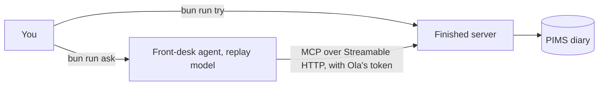

# Start here

## After this part you can

Run the finished clinic server and read facts off it.

## You leave with

An `answers.md` file with three facts you read from the finished system.

## The problem

You are the only engineer at Harrow Lane Veterinary, a group of three small-animal clinics. Your boss asks you to let
the team use Claude with the diary and the records, without anyone seeing what they should not. For example, Ola the receptionist may book visits but not read notes. Before you build
anything, you need to see the clinic's data, the finished server, and what "done" looks like.

The diagram shows the two ways you talk to the finished server. `bun run ask` goes through an agent and a model.
`bun run try` calls one tool directly.



## Steps

| Step              | You produce                                            | The check reads           |
| ----------------- | ------------------------------------------------------ | ------------------------- |
| `meet-the-clinic` | `answers.md`: three facts read off the finished system | a fresh copy of the diary |

## Walkthrough

```bash
bun run verify meet-the-clinic
```

Expect: `Done. All 4 rules pass.` once `answers.md` holds your three answers. Before that, the same command prints four
`FAIL` lines. Each has a `Try next:` line that names the command to run.

## Watch and read

| Kind  | Title                                       | Author                  | Why                                                          | Link                                                                 |
| ----- | ------------------------------------------- | ----------------------- | ------------------------------------------------------------ | -------------------------------------------------------------------- |
| video | Building Agents with Model Context Protocol | Mahesh Murag, Anthropic | A full workshop that shows what MCP is and why it exists     | <https://www.youtube.com/watch?v=kQmXtrmQ5Zg>                        |
| video | MCP: Origins and Requests For Startups      | Theodora Chu, Anthropic | An MCP product manager explains where the protocol came from | <https://www.youtube.com/watch?v=x-8pBqWiTzk>                        |
| read  | Introducing the Model Context Protocol      | Anthropic               | The announcement that says what MCP is and why it was made   | <https://www.anthropic.com/news/model-context-protocol>              |
| read  | Architecture overview                       | MCP maintainers         | Names the host, the client and the server you will meet      | <https://modelcontextprotocol.io/docs/2026-07-28/learn/architecture> |

## Project

Pick one real system you use at work, such as a diary, a ticket list or a shared sheet. Write three facts about it in
a file called `my-system.md`: what it holds, who may see it, and one question a person asks it every day.
