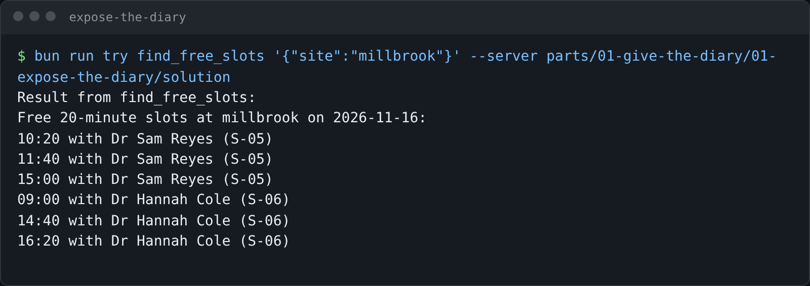

# Expose the diary

## The problem

The Millbrook front desk gets calls all day. Callers ask, "When can you see my dog?" Staff open the PIMS, pick a vet and
scan the diary. Claude cannot see the diary yet.

For example, the PIMS search `clinic.freeSlots` finds 6 free slots for Millbrook. But a model cannot call that search yet.

## Watch it done

The starter has no tool. This is real output:

```text
  FAIL  tools/list has a tool called find_free_slots
  FAIL  Its description is one to three sentences of at least 8 words
  FAIL  It takes site and length, and every argument has a description
  FAIL  For Millbrook and one visit length it returns exactly the free slots in the diary
  FAIL  It reads the live diary: a slot booked behind its back disappears from the next answer
3 of 8 rules pass. Fix the FAIL lines and run it again.
```

The sample solution ends with `Done. All 8 rules pass.` It answers like this:



## Your turn

1. In `server.ts`, import `z` from `zod/v4`. Import `clinic` from `#clinic`. That path points to `world/clinic.ts`.
2. Register `find_free_slots` with `server.registerTool(name, { description, inputSchema }, handler)`.
3. Give it a Zod object. It has `site` (`harrow-lane`, `millbrook` or `eastgate`), an optional `date`, and a `length`. The length defaults to 20.
4. Add `.describe("...")` to every field.
5. On every call, the handler calls `clinic.freeSlots({ site, date, length })`. It returns each time and vet as text. If there is no `date`, use `clinic.clock().date`.
6. Log only with `console.error`. Stdout belongs to the protocol.
7. Try it the way a client does.

```bash
bun run try find_free_slots '{"site":"millbrook"}' --server parts/01-give-the-diary/01-expose-the-diary/problem
```

Expect: six start times, three for Dr Sam Reyes and three for Dr Hannah Cole. The starter says
`The server broke the MCP rules: Method not found.`

## Do it on your work

Do the same for one read action in your own system, such as "list open tickets". A good tool has a clear description,
and each argument has its own. It reads the answer live each time. It never copies an old answer.

## Done when

- The server starts over stdio. It writes nothing to stdout before a request. It answers `server/discover`.
- `tools/list` has `find_free_slots`. Its description is one to three sentences.
- It takes `site` and `length`. Every argument has a description.
- For Millbrook and one visit length, it returns exactly the free slots in the diary. A slot booked behind its back disappears.

```bash
bun run verify expose-the-diary
```

Expect: `Done. All 8 rules pass.`

## Solution

The finished state is a `server.ts` with one registered tool. See `solution/server.ts`.

## If you get stuck

- You write only one schema, `inputSchema`. The SDK checks every call against it.
- Old tutorials use `server.tool(...)` and `@modelcontextprotocol/sdk`. That is the old SDK. Use `registerTool` from `@modelcontextprotocol/server`.
- Guide: [Build your first server](https://ts.sdk.modelcontextprotocol.io/v2/get-started/first-server).

## Go further

The check reads stdout before any request. A banner printed to stdout passes this check. But it breaks other hosts.

## Words you will use

- **PIMS**: the clinic's record system. It holds the diary, patients and owners.
- **stdio**: standard input and output. The host starts your server and sends it messages through stdin and stdout.
- **`tools/list`**: the request a host sends to learn your tools and their argument schemas.
- **`server/discover`**: the first request in the current spec. The server says what it supports.
- **Zod**: the TypeScript schema library that the SDK uses for tool arguments.
