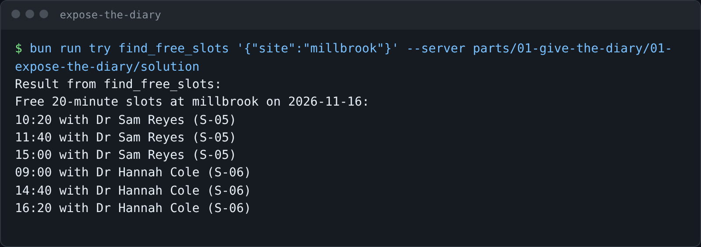

# Expose the diary

## The problem

The Millbrook front desk answers "when can you see my dog?" all the time. The answer means clicking into
the PIMS, picking a vet, and scanning their diary. Claude could answer in one line, but it cannot see the diary.
The PIMS already has a "find a slot" search (`clinic.freeSlots`). Nothing connects it to a model.

## Your challenge

Turn `server.ts` in this folder into an MCP server with one read tool, `find_free_slots`, served over stdio.

1. Register the tool with `server.registerTool(name, { description, inputSchema }, handler)`.
2. Arguments: `site` (one of `harrow-lane`, `millbrook`, `eastgate`), an optional `date` (YYYY-MM-DD), and
   `length` in minutes (default 20). Use a Zod object and give every field a `.describe("...")`.
3. The handler calls `clinic.freeSlots({ site, date, length })` on every call and returns each start time and vet
   as text. Leave `date` out and use `clinic.clock().date`.
4. Log only with `console.error`. Over stdio, stdout belongs to the protocol.

Try your server as a client would, before you run the check:

```bash
bun run try find_free_slots '{"site":"millbrook"}' --server parts/01-give-the-diary/01-expose-the-diary/problem
```

Expect: `Result from find_free_slots:` and six start times, three for Dr Sam Reyes and three for Dr Hannah Cole.



If you already know this: the check also spawns your server raw and reads stdout before any request. A banner on
stdout passes the SDK client here but breaks other hosts.

## Done when

- The server starts over stdio and answers an MCP client.
- It writes nothing to stdout until a client asks something.
- It speaks the current MCP spec revision (it answers `server/discover`).
- `tools/list` has a tool called `find_free_slots`.
- Its description is one to three sentences of at least 8 words.
- It takes `site` and `length`, and every argument has a description.
- For Millbrook and 20 minutes it returns exactly the free slots in the diary.
- It reads the live diary: a slot booked behind its back disappears from the next answer.

```bash
bun run verify expose-the-diary
```

Expect: `Done. All 8 rules pass.` once your work meets every Done when line. Before that, each FAIL line has a `Try next:`.

## If you get stuck

- The SDK's own first-server guide is short: https://ts.sdk.modelcontextprotocol.io/v2/ (Get started, Build your first server).
- `inputSchema` is the only schema you write. The SDK turns it into the JSON Schema the model sees, and checks every
  call against it before your handler runs.
- Old tutorials use `server.tool(...)` and `@modelcontextprotocol/sdk`. That is SDK v1. Use `registerTool` from
  `@modelcontextprotocol/server`.
- Compare with `../solution/server.ts` if you are stuck for long. A worked first tool teaches more than a blank page.

## Words you will use

- **stdio**: standard input and output. The host starts your server as a child process and talks JSON-RPC over its stdin and stdout.
- **JSON-RPC**: the message format MCP uses: a request with a `method` and `params`, and a reply with a `result` or an `error`.
- **`tools/list`**: the request a host sends to learn your tools, their descriptions and their argument schemas.
- **`server/discover`**: the first request in the current spec revision. The server says which versions and features it supports.
- **Zod**: the TypeScript schema library the SDK uses for tool arguments.
