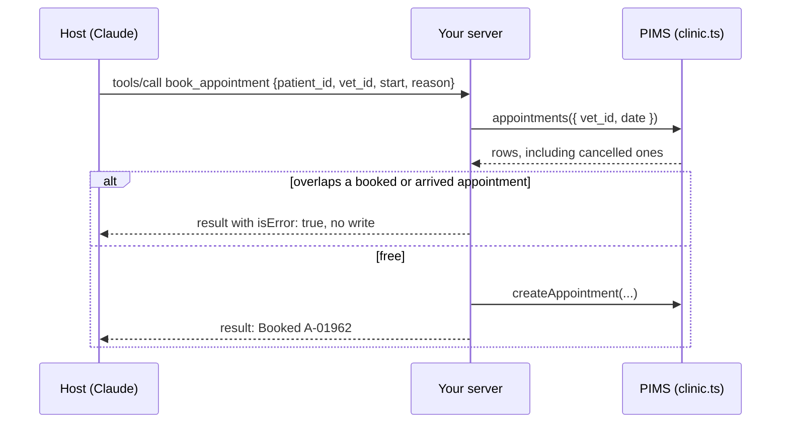

# Book an appointment

## The problem

Reading the diary is safe. Writing to it is not. The Harrow Lane PIMS lets a vet be double-booked on purpose,
because vets squeeze in emergencies. So `clinic.createAppointment` writes whatever it is given. If Claude books
Biscuit at a time Dr Reyes is already seeing another dog, two owners turn up for one slot, and the front desk has
to phone one of them back.

There is a second trap. When an owner cancels, the PIMS keeps the row with status `cancelled`. That time is free.



## Your challenge

Add a tool `book_appointment(patient_id, vet_id, date?, start, length, reason)` to `server.ts`.

1. Read the vet's appointments for that date with `clinic.appointments({ vet_id, date })`.
2. Keep only `booked` and `arrived` rows. Two appointments clash when each starts before the other ends.
3. On a clash, return `{ content: [...], isError: true }` and write nothing.
4. Otherwise call `clinic.createAppointment(...)` once and say what was booked.
5. Give `start` a Zod rule (`HH:MM`), so bad input is refused before your handler runs.

```bash
bun run try book_appointment '{"patient_id":"P-0001","vet_id":"S-05","start":"10:20","reason":"Booster"}' --server parts/01-give-the-diary/02-book-an-appointment/problem
```

Expect: `Result from book_appointment:` and a booking line. `bun run world reset` undoes it.

If you already know this: compare minutes, not strings, and test an overlap that starts inside another appointment.

## Done when

- The server starts and answers an MCP client.
- `tools/list` has `book_appointment` with `patient_id`, `vet_id`, `start` and `reason`.
- Booking Biscuit with Dr Reyes at 10:20 adds exactly one matching row to the diary.
- A slot freed by a cancellation can be booked (Dr Reyes at 11:40).
- Booking a time that is already taken adds no row and returns `isError: true`.
- A booking that starts in the middle of another appointment is refused too (Dr Reyes at 10:30).
- Arguments that fail the schema come back as a tool error the model can read, and add no row.

```bash
bun run verify book-an-appointment
```

Expect: `Done. All 7 rules pass.`

## If you get stuck

- The check runs on a fresh copy of the diary each time, so your own test bookings never break it.
- A tool error (`isError: true`) is a normal result the model reads and acts on. A thrown protocol error is for the
  host's code, and the model never sees it. For tools, the SDK turns a thrown error into a tool error for you.
- The solution opens after you try: `../solution/server.ts`.

## Words you will use

- **Tool error**: a successful reply with `isError: true` and text that explains the failure to the model.
- **Protocol error**: a JSON-RPC `error` reply, for a request the server cannot handle at all.
- **Clash**: two appointments for one vet whose times overlap.
- **System of record**: the place the clinic trusts for the truth, here the PIMS diary. Your server is a layer on top.
