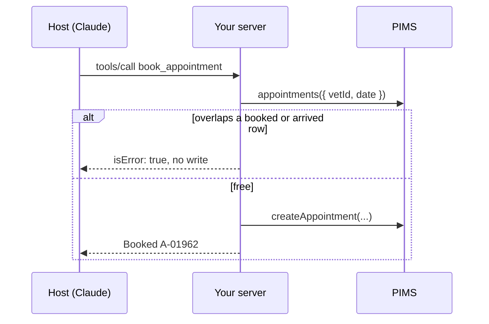

# Book an appointment

## The problem

Reading the diary is safe. Writing is not. The PIMS lets staff double-book a vet on purpose, so
`clinic.createAppointment` writes whatever it gets. For example, if Claude books Biscuit at 10:20 while Dr Reyes
already sees a dog, two owners arrive for one slot. A cancelled row stays, but its time is free.

## Watch it done

The starter has no booking tool. Real output of the check:

```text
  FAIL  tools/list has book_appointment with patientId, vetId, start and reason
  FAIL  Booking Biscuit with Dr Reyes at 10:20 adds exactly one matching row to the diary
  FAIL  A slot freed by a cancellation can be booked (Dr Reyes at 11:40)
  FAIL  Booking a time that is already taken adds no row and returns isError: true
  FAIL  A booking that starts in the middle of another appointment is refused too (Dr Reyes at 10:30)
  FAIL  Arguments that fail the schema come back as a tool error the model can read, and add no row
1 of 7 rules pass. Fix the FAIL lines and run it again.
```

The sample solution ends with `Done. All 7 rules pass.`

## Your turn

1. Add `book_appointment(patientId, vetId, date?, start, length, reason)` to `server.ts`.
2. Read the vet's rows with `clinic.appointments({ vetId, date })`. Keep only `booked` and `arrived` rows.
3. Two appointments clash when each starts before the other ends. Compare minutes, not strings.
4. On a clash, return `{ content: [...], isError: true }` and write nothing. Otherwise call
   `clinic.createAppointment(...)` once.
5. Give `start` a Zod rule (`HH:MM`), so the SDK refuses bad input first.
6. Run it twice.

```bash
bun run try book_appointment '{"patientId":"P-0001","vetId":"S-05","start":"10:20","reason":"Booster"}' --server parts/01-give-the-diary/02-book-an-appointment/problem
```

Expect: first `Booked A-01962: 10:20 on 2026-11-16.`, then a tool error that says `Clash`. Undo with
`bun run world reset`.

## Do it on your work

Do the same on one write action of your own system. First list what would make a write wrong, such as a double
booking. Good looks like a check before the write, a refusal that writes nothing, and a test of a half-overlap.

## Done when

- `tools/list` has `book_appointment` with `patientId`, `vetId`, `start` and `reason`.
- Biscuit with Dr Reyes at 10:20 adds exactly one row, and a freed slot (11:40) can be booked.
- A taken time, or one that starts mid-appointment (10:30), adds no row and returns `isError: true`.
- Arguments that fail the schema come back as a tool error and add no row.

```bash
bun run verify book-an-appointment
```

Expect: `Done. All 7 rules pass.`

## Solution

The after state is `server.ts` with a second tool and a clash check before the write. See `solution/server.ts`.

## If you get stuck

- The check uses a fresh diary, so your test bookings never break it.
- A tool error (`isError: true`) is a normal result. The model reads it. A protocol error is for the host's code, and
  the model never sees it.

## Go further



## Words you will use

- **Tool error**: a reply with `isError: true` and text that explains the failure to the model.
- **Clash**: two appointments for one vet whose times overlap.
- **System of record**: the place the clinic trusts for the truth, here the PIMS diary.
