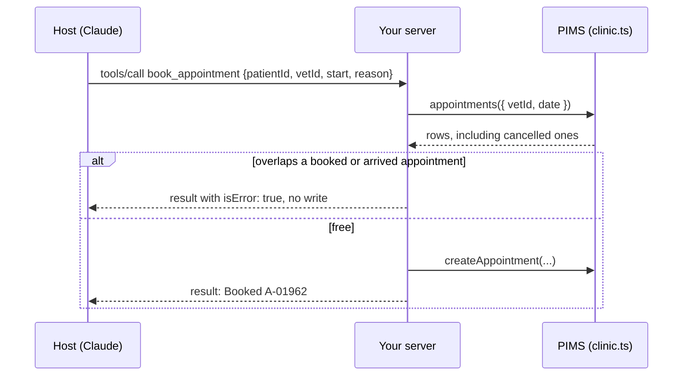

# Book an appointment

## The problem

Reading the diary is safe. Writing to it is not. The Harrow Lane PIMS lets staff double-book a vet on purpose,
because vets squeeze in emergencies. So `clinic.createAppointment` writes whatever it gets.

Say Claude books Biscuit when Dr Reyes already sees another dog. Two owners come for one slot, and the front desk
phones one back.

There is a second trap. When an owner cancels, the PIMS keeps the row with status `cancelled`. That time is free.



## Your challenge

Add a tool `book_appointment(patientId, vetId, date?, start, length, reason)` to `server.ts`.

1. Read the vet's appointments for that date with `clinic.appointments({ vetId, date })`.
2. Keep only `booked` and `arrived` rows. Two appointments clash when each starts before the other ends.
3. On a clash, return `{ content: [...], isError: true }` and write nothing.
4. Otherwise call `clinic.createAppointment(...)` once and say what was booked.
5. Give `start` a Zod rule (`HH:MM`). Then the SDK refuses bad input before your handler runs.

```bash
bun run try book_appointment '{"patientId":"P-0001","vetId":"S-05","start":"10:20","reason":"Booster"}' --server parts/01-give-the-diary/02-book-an-appointment/problem
```

Expect: a result for `book_appointment` and a booking line. `bun run world reset` undoes it.

For example, run it twice on the sample solution. The first run books Biscuit (P-0001) with Dr Reyes (S-05). The
second run refuses:

```text
Result from book_appointment:
Booked A-01962: 10:20 on 2026-11-16.

Tool error from book_appointment:
Clash: the vet is already booked at 10:20.
```

If you already know this: compare minutes, not strings. Test an overlap that starts inside another appointment.

## Done when

- The server starts and answers an MCP client.
- `tools/list` has `book_appointment` with `patientId`, `vetId`, `start` and `reason`.
- Booking Biscuit with Dr Reyes at 10:20 adds exactly one matching row to the diary.
- A slot freed by a cancellation can be booked (Dr Reyes at 11:40).
- Booking a time that is already taken adds no row and returns `isError: true`.
- A booking that starts in the middle of another appointment is refused too (Dr Reyes at 10:30).
- Arguments that fail the schema come back as a tool error the model can read, and add no row.

```bash
bun run verify book-an-appointment
```

Expect: `Done. All 7 rules pass.` once your work meets every Done when line. Before that, each FAIL line has a `Try next:`.

## If you get stuck

- The check uses a fresh copy of the diary, so your test bookings never break it.
- A tool error (`isError: true`) is a normal result. The model reads it and acts on it. A thrown protocol error is
  for the host's code, and the model never sees it. In a tool, the SDK turns a thrown error into a tool error.
- The solution is there after you try: `../solution/server.ts`.

## Words you will use

- **Tool error**: a successful reply with `isError: true` and text that explains the failure to the model.
- **Protocol error**: a JSON-RPC `error` reply, for a request the server cannot handle at all.
- **Clash**: two appointments for one vet whose times overlap.
- **System of record**: the place the clinic trusts for the truth, here the PIMS diary. Your server is a layer on top.
