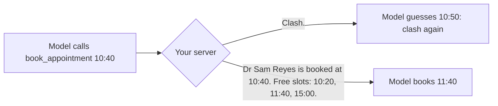

# Return errors the model can fix

## The problem

Your server refuses bad bookings now, but its error says only "Clash". The model gives up, or it guesses another
time that also clashes.

Every failed guess costs a tool call and tokens, and a receptionist waits. The error text is the model's only help. Anthropic's guide to writing tools for agents gives this advice. Error responses should "clearly
communicate specific and actionable improvements", not opaque codes
([Writing effective tools for agents](https://www.anthropic.com/engineering/writing-tools-for-agents)).



For example, ask for Biscuit with Dr Reyes at 10:40. The starter in this folder prints this:

```text
Clash: the vet is already booked at 10:40.
```

The sample solution prints this. With it, the model can book 11:40 next.

```text
Dr Sam Reyes is booked at 10:40, which clashes with 10:40. Free slots: 10:20, 11:40, 15:00.
```

## Your challenge

Make every refusal in `book_appointment` say what is wrong and what to do next. The check sends five bad calls.
Handle them in this order, before the clash check:

| Bad call                 | Your error must contain                                                   |
| ------------------------ | ------------------------------------------------------------------------- |
| Unknown patient `P-9999` | `patientId` and the id that was sent                                      |
| A start in the past      | the word "past" and the clinic clock's date and time (`clinic.clock()`)   |
| A clash with Dr Reyes    | the vet's name, then `Free slots:` and real times from `clinic.freeSlots` |
| 18:30 at Millbrook       | the opening and closing times (`clinic.openingHours(site, date)`)         |
| `length` of 25           | `length` and the values that work, 10 to 60                               |

For the length, put the message on the Zod rule, for example
`.multipleOf(10, { error: "length must be 10 to 60 minutes, in steps of 10" })`. The SDK sends it to the model.

If you already know this: the check compares every time after `Free slots:` with the diary. Typed-in slots fail.

## Done when

- The server starts and answers an MCP client.
- An unknown patient: the error names `patientId` and the id that was sent.
- A start in the past: the error says it is in the past and gives the clinic clock.
- A clash: the error names the vet and lists real free slots after "Free slots:".
- Outside opening times: the error gives the opening and closing times.
- A length of 25 (not a step of ten): the error names `length` and the values that work (10 to 60).
- None of the five bad calls wrote to the diary, and a good booking still adds one row.

```bash
bun run verify return-errors-the-model-can-fix
```

Expect: `Done. All 7 rules pass.` once your work meets every Done when line. Before that, each FAIL line has a `Try next:`.

## If you get stuck

- See one error with `bun run try book_appointment '{"patientId":"P-0001","vetId":"S-05","start":"10:40","reason":"Booster"}' --server <this folder>`.
- `clinic.staffMember(vetId)` gives the vet's name and site. `clinic.patient(id)` is `undefined` for an unknown id.
- The solution is there after you try: `../solution/server.ts`.

## Words you will use

- **Actionable error**: an error that tells the reader the next step, not only that something failed.
- **Clinic clock**: the world's "now", from `clinic.clock()`. The course never reads your computer's clock, so answers never change.
- **Opening times**: when a site takes appointments. `clinic.openingHours(site, date)` returns `null` when the site is closed.
