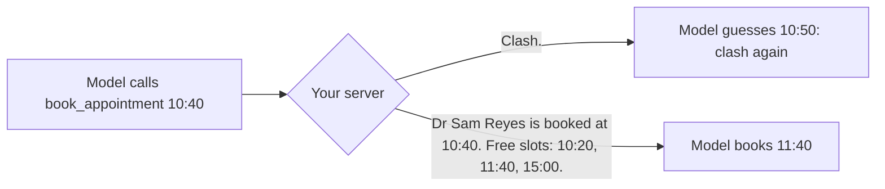

# Return errors the model can fix

## The problem

Your server refuses bad bookings now, but it says "Clash: the vet is already booked at 10:40." The model reads that
and gives up, or guesses another time that also clashes. Every failed guess is another tool call, more tokens, and
a receptionist waiting. The error text is the only help the model gets. Anthropic's guide to writing tools for
agents says to make error responses "clearly communicate specific and actionable improvements" instead of opaque
codes ([Writing effective tools for agents](https://www.anthropic.com/engineering/writing-tools-for-agents)).



## Your challenge

Make every refusal in `book_appointment` name what is wrong and what to do next. The check sends five planted bad
calls. Handle them in this order, before the clash check:

| Bad call | Your error must contain |
|---|---|
| Unknown patient `P-9999` | `patient_id` and the id that was sent |
| A start in the past | the word "past" and the clinic clock's date and time (`clinic.clock()`) |
| A clash with Dr Reyes | the vet's name, then `Free slots:` and real times from `clinic.freeSlots` |
| 18:30 at Millbrook | the opening and closing times (`clinic.openingHours(site, date)`) |
| `length` of 25 | `length` and the values that work, 10 to 60 |

For the length, put the message on the Zod rule, for example
`.multipleOf(10, { error: "length must be 10 to 60 minutes, in steps of 10" })`. The SDK sends that text to the model.

If you already know this: the check compares every time after `Free slots:` with the diary, so slots typed in by
hand fail even when they look right.

## Done when

- The server starts and answers an MCP client.
- An unknown patient: the error names `patient_id` and the id that was sent.
- A start in the past: the error says it is in the past and gives the clinic clock.
- A clash: the error names the vet and lists real free slots after "Free slots:".
- Outside opening hours: the error gives the opening and closing times.
- A length of 25 minutes: the error names `length` and the values that work (10 to 60).
- None of the five bad calls wrote to the diary, and a good booking still adds one row.

```bash
bun run verify return-errors-the-model-can-fix
```

Expect: `Done. All 7 rules pass.`

## If you get stuck

- See one error with `bun run try book_appointment '{"patient_id":"P-0001","vet_id":"S-05","start":"10:40","reason":"Booster"}' --server <this folder>`.
- `clinic.staffMember(vet_id)` gives the vet's name and site; `clinic.patient(id)` is `undefined` for an unknown id.
- The solution opens after you try: `../solution/server.ts`.

## Words you will use

- **Actionable error**: an error that tells the reader the next step, not only that something failed.
- **Clinic clock**: the world's "now", from `clinic.clock()`. The course never reads your computer's clock, so every run gets the same answers.
- **Opening hours**: when a site takes appointments. `clinic.openingHours(site, date)` returns `null` when the site is closed.
