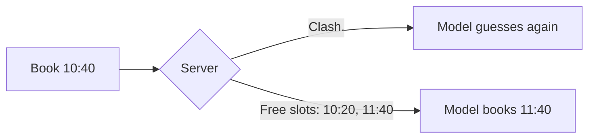

# Return errors the model can fix

## The problem

Your server refuses bad bookings, but the error says only "Clash". For example, Biscuit at 10:40 with Dr Reyes fails,
and the model guesses 10:50, which fails too. Each wrong guess costs a tool call, tokens and a receptionist's wait.



## Watch it done

The starter replies:

```text
Tool error from book_appointment:
Clash: the vet is already booked at 10:40.
```

Real output of its check:

```text
  FAIL  An unknown patient: the error names patientId and the id that was sent
  FAIL  A start in the past: the error says it is in the past and gives the clinic clock
  FAIL  A clash: the error names the vet and lists real free slots after "Free slots:"
  FAIL  Outside opening times: the error gives the opening and closing times
  FAIL  A length of 25 minutes: the error names length and the values that work (10 to 60)
1 of 7 rules pass. Fix the FAIL lines and run it again.
```

The sample solution replies as below, and the check ends with `Done. All 7 rules pass.`

```text
Tool error from book_appointment:
Dr Sam Reyes is booked at 10:40, which clashes with 10:40. Free slots: 10:20, 11:40, 15:00.
```

## Your turn

1. Start with the clash. Call `clinic.freeSlots` for that vet and write the times after `Free slots:`. Never type
   times by hand.
2. Try it.

```bash
bun run try book_appointment '{"patientId":"P-0001","vetId":"S-05","start":"10:40","reason":"Booster"}' --server parts/01-give-the-diary/03-return-errors-the-model-can-fix/problem
```

Expect: an error that names Dr Sam Reyes and lists free times.

3. Handle the other four bad calls before the clash check. Each error must contain:

| Bad call                 | Your error must contain                                 |
| ------------------------ | ------------------------------------------------------- |
| Unknown patient `P-9999` | `patientId` and the id that was sent                    |
| A start in the past      | the word "past" and the clinic clock (`clinic.clock()`) |
| 18:30 at Millbrook       | opening and closing times (`clinic.openingHours`)       |
| `length` of 25           | `length` and the values that work, 10 to 60             |

For the length, put the message on the Zod rule: `.multipleOf(10, { error: "length must be 10 to 60 minutes" })`.

## Do it on your work

Take one refusal in your own tool. Rewrite it to name the field, say what is wrong and offer a real next step from
live data. Good looks like an error a stranger could act on without asking you.

## Done when

- An unknown patient, a past start, an opening-hours miss and a length of 25 each get the error in the table.
- A clash names the vet and lists real free slots after "Free slots:".
- None of the five bad calls wrote to the diary, and a good booking still adds one row.

```bash
bun run verify return-errors-the-model-can-fix
```

Expect: `Done. All 7 rules pass.`

## Solution

The after state is a `server.ts` where every refusal says what is wrong and what to do next. See
`solution/server.ts`.

## If you get stuck

- `clinic.staffMember(vetId)` gives the vet's name. `clinic.patient(id)` is `undefined` for an unknown id.

## Go further

Anthropic says errors should "clearly communicate specific and actionable improvements":
[Writing effective tools for agents](https://www.anthropic.com/engineering/writing-tools-for-agents).

## Words you will use

- **Actionable error**: an error that tells the reader the next step, not only that something failed.
