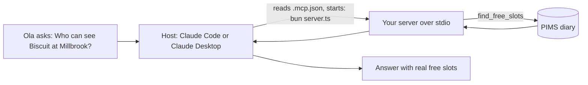

# Connect Claude

## The problem

A server nobody can use helps nobody. Ola at the Millbrook desk will not type JSON into a terminal. She will ask
Claude. The last step is to tell a real host how to start your server, and to see the model use your tools to
answer a real question from the live diary.



## Your challenge

1. Create `.mcp.json` in this folder. It tells the host the command that starts your server:

   ```json
   { "mcpServers": { "harrow-lane": { "command": "bun", "args": ["server.ts"] } } }
   ```

2. Connect a host.
   - Claude Code: open a terminal in this folder, run `claude`, approve the `harrow-lane` server, and check it with `/mcp`.
   - Claude Desktop: add the same entry to its config file under Settings, Developer. Use full paths there, for
     example `"args": ["/full/path/to/this/folder/server.ts"]`, because Desktop does not start in this folder.
3. Ask: "Who can see Biscuit at Millbrook?" Paste the whole answer after `Answer:` in `notes/connect-claude.md`.

Run the command from your config yourself first. If it starts and waits quietly, the host can start it too:

```bash
cd parts/01-give-the-diary/04-connect-claude/problem && bun server.ts
```

Expect: `harrow-lane server running on stdio`, then nothing. Press Ctrl+C to stop it.

If you already know this: the check launches exactly the command and args in `.mcp.json`, with this folder as the
working directory, and compares every time in Claude's answer with the diary.

## Done when

- `.mcp.json` names one server under `mcpServers`, with a command.
- Starting that exact command gives a working MCP server.
- That server lists `find_free_slots` and `book_appointment`.
- `notes/connect-claude.md` has the question and Claude's answer.
- The answer names a Millbrook vet and at least one real free slot.
- Every time in the answer is a free slot in the diary (nothing made up).

```bash
bun run verify connect-claude
```

Expect: `Done. All 6 rules pass.`

## If you get stuck

- Claude says it cannot see the diary: the server is not connected. In Claude Code run `/mcp`; in Claude Desktop open
  Settings, Developer, and read the server's log.
- Times in the answer that are not free: you booked some while testing. Run `bun run world reset` and ask again.
- Any MCP host works (VS Code, Cursor, others). The check only reads `.mcp.json` and your notes.

## Words you will use

- **`.mcp.json`**: a project file that lists MCP servers and the command that starts each one. Claude Code reads it.
- **Host config**: where a host keeps its list of servers. Claude Desktop keeps its own, with the same shape.
- **Working directory**: the folder a command runs in. A relative path such as `server.ts` is read from there.
