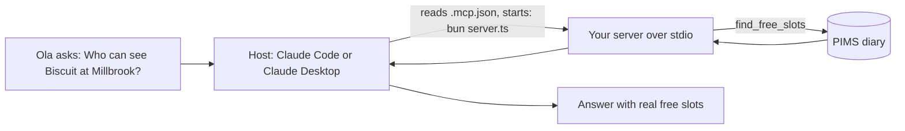

# Connect Claude

## The problem

A server that nobody can use helps nobody. Ola at the Millbrook desk will not type JSON into a terminal. She asks
Claude. A host is the app she talks to, such as Claude Code or Claude Desktop.

In this last step, you tell a real host how to start your server. Then you watch the model use your tools. It
answers a real question from the live diary.



## Your challenge

1. Create `.mcp.json` in this folder. It tells the host the command that starts your server:

   ```json
   { "mcpServers": { "harrow-lane": { "command": "bun", "args": ["server.ts"] } } }
   ```

2. Connect a host.
   - Claude Code: open a terminal in this folder and run `claude`. Approve the `harrow-lane` server, and check it with `/mcp`.
   - Claude Desktop: add the same entry to its config file under Settings, Developer. Use full paths there, for
     example `"args": ["/full/path/to/this/folder/server.ts"]`. Desktop does not start in this folder.
3. Ask: "Who can see Biscuit at Millbrook?" Paste the whole answer after `Answer:` in `notes/connect-claude.md`.

First, run the command from your config yourself. Does it start and wait quietly? Then the host can start it too:

```bash
cd parts/01-give-the-diary/04-connect-claude/problem && bun server.ts
```

Expect: `harrow-lane server running on stdio`, then nothing. Press Ctrl+C to stop it.

For example, the sample solution's `notes/connect-claude.md` ends with this answer. Every time in it is a free slot
in the diary:

```text
Answer: Claude called find_free_slots for millbrook and said: Dr Sam Reyes is free at 10:20, 11:40 and 15:00,
and Dr Hannah Cole is free at 09:00, 14:40 and 16:20. Would you like me to book one of these for Biscuit?
```

If you already know this: the check starts exactly the command and args in `.mcp.json`, in this folder. Then it
compares every time in Claude's answer with the diary.

## Done when

- `.mcp.json` names one server under `mcpServers`, with a command.
- Starting that exact command gives a working MCP server.
- That server lists `find_free_slots` and `book_appointment`.
- `notes/connect-claude.md` has the question and Claude's answer.
- The answer names a Millbrook vet and at least one real free slot.
- Every time in the answer is a free slot in the diary (nothing made up).

```bash
bun run verify connect-claude
```

Expect: `Done. All 6 rules pass.` once your work meets every Done when line. Before that, each FAIL line has a `Try next:`.

## If you get stuck

- Claude says it cannot see the diary: the server is not connected. In Claude Code, run `/mcp`. In Claude Desktop,
  open Settings, Developer, and read the server's log.
- The answer has times that are not free: you booked some while you tested. Run `bun run world reset` and ask again.
- Any MCP host works (VS Code, Cursor, others). The check only reads `.mcp.json` and your notes.

## Words you will use

- **`.mcp.json`**: a project file that lists MCP servers and the command that starts each one. Claude Code reads it.
- **Host config**: where a host keeps its list of servers. Claude Desktop keeps its own, with the same shape.
- **Working directory**: the folder a command runs in. A relative path such as `server.ts` is read from there.
