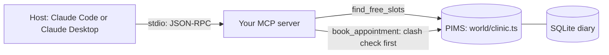

# Give the diary to the model

## The problem

The Millbrook front desk spends a lot of time on the phone, booking and moving appointments. Staff want to ask
Claude "who can see Biscuit?". Then Claude books the slot, and nobody clicks through the PIMS. The PIMS (practice
management system) is the clinic's main record of patients and appointments.

The PIMS has an API, but a model cannot use an API it has never seen. Also, the PIMS double-books a vet if you ask
it to. In this part you build the first safe bridge between Claude and the PIMS:

- an MCP server, a program that offers tools to a model, with one read tool and one write tool,
- stdio (standard input and output), the way the host and your server talk,
- errors the model can act on,
- a real host, such as Claude Code, connected to it.

For example, by the end of this part, a bad booking for Biscuit at 10:40 gets this reply from your server. The
model reads it and books 11:40 next:

```text
Tool error from book_appointment:
Dr Sam Reyes is booked at 10:40, which clashes with 10:40. Free slots: 10:20, 11:40, 15:00.
```

## Why it matters

Tool results and errors are the model's only view of your system. Anthropic's tool-writing guide shows one answer in
two forms. The detailed form takes 206 tokens, and the short form takes 72 tokens. A token is a small piece of text
that a model reads. The guide also notes that Claude Code limits a tool response to 25,000 tokens by default. It
tells tool authors to write errors that give "specific and actionable improvements", not opaque codes.
Source: [Writing effective tools for agents](https://www.anthropic.com/engineering/writing-tools-for-agents),
Anthropic Engineering, read for this course.



## Steps

| Step                              | Minutes | You produce                            | The check reads                                                                              |
| --------------------------------- | ------- | -------------------------------------- | -------------------------------------------------------------------------------------------- |
| `expose-the-diary`                | 15      | a stdio server with `find_free_slots`  | `tools/list`, a live call, stdout before any request, a slot booked behind the server's back |
| `book-an-appointment`             | 15      | `book_appointment` with a clash check  | the diary rows after each of five calls                                                      |
| `return-errors-the-model-can-fix` | 10      | errors that name the field and the fix | five planted bad calls, the free slots in the diary                                          |
| `connect-claude`                  | 10      | `.mcp.json` and Claude's answer        | the server started from your config, every time in the answer                                |

Each step's starter is the sample solution of the step before it. So you can start any step fresh. Do you want to
keep your own code instead? Then copy your `server.ts` into the next step's `problem/` folder.

## Walkthrough

```bash
bun run verify expose-the-diary
```

Expect: `Done. All 8 rules pass.` once your work meets every Done when line. Before that, each FAIL line has a `Try next:`.

```bash
bun run verify book-an-appointment
```

Expect: `Done. All 7 rules pass.` once your work meets every Done when line. Before that, each FAIL line has a `Try next:`.

```bash
bun run verify return-errors-the-model-can-fix
```

Expect: `Done. All 7 rules pass.` once your work meets every Done when line. Before that, each FAIL line has a `Try next:`.

```bash
bun run verify connect-claude
```

Expect: `Done. All 6 rules pass.` once your work meets every Done when line. Before that, each FAIL line has a `Try next:`.

```bash
bun run verify part give-the-diary
```

Expect: `Part give-the-diary is done: 4/4 steps pass.` once every step passes.
