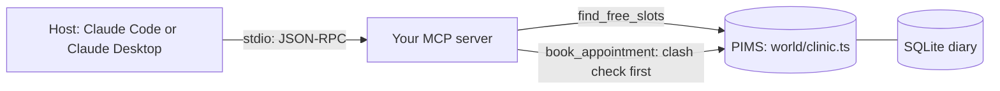

# Give the diary to the model

## After this part you can

Put one read tool and one safe write tool on an MCP server and connect Claude to it.

## You leave with

A working stdio server with `find_free_slots` and `book_appointment`, plus a `.mcp.json` that starts it.

## The problem

The Millbrook front desk spends a lot of time on the phone, booking and moving appointments. Staff want to ask Claude
"who can see Biscuit?" and have it book the slot. A model cannot use the practice system (PIMS) API it has never seen,
and the PIMS double-books a vet if you let it. Anthropic's tool-writing guide shows one answer in two forms: the
detailed one takes 206 tokens, the short one 72. A token is a small piece of text a model reads. You build the first
safe bridge. For example, a bad booking for Biscuit at 10:40 gets this reply, and the model books 11:40 next:

```text
Tool error from book_appointment:
Dr Sam Reyes is booked at 10:40, which clashes with 10:40. Free slots: 10:20, 11:40, 15:00.
```



## Steps

| Step                              | You produce                            | The check reads                                                                              |
| --------------------------------- | -------------------------------------- | -------------------------------------------------------------------------------------------- |
| `expose-the-diary`                | a stdio server with `find_free_slots`  | `tools/list`, a live call, stdout before any request, a slot booked behind the server's back |
| `book-an-appointment`             | `book_appointment` with a clash check  | the diary rows after each of five calls                                                      |
| `return-errors-the-model-can-fix` | errors that name the field and the fix | five planted bad calls, the free slots in the diary                                          |
| `connect-claude`                  | `.mcp.json` and Claude's answer        | the server started from your config, every time in the answer                                |

Each step's starter is the sample solution of the step before it. So you can start any step fresh. Do you want to
keep your own code instead? Then copy your `server.ts` into the next step's `problem/` folder.

## Walkthrough

```bash
bun run verify expose-the-diary
bun run verify book-an-appointment
bun run verify return-errors-the-model-can-fix
bun run verify connect-claude
```

Expect: `Done. All 8 rules pass.`, then `All 7`, `All 7` and `All 6`, once your work meets every Done when line. Before
that, each FAIL line has a `Try next:`.

```bash
bun run verify part give-the-diary
```

Expect: `Part give-the-diary is done: 4/4 steps pass.` once every step passes.

## Watch and read

| Kind  | Title                                            | Author                      | Why                                                                      | Link                                                                    |
| ----- | ------------------------------------------------ | --------------------------- | ------------------------------------------------------------------------ | ----------------------------------------------------------------------- |
| read  | Writing effective tools for agents               | Anthropic Engineering       | The source for short results and errors a model can act on               | <https://www.anthropic.com/engineering/writing-tools-for-agents>        |
| read  | Build an MCP server                              | MCP maintainers             | The official guide to a first server and to connecting a host            | <https://modelcontextprotocol.io/docs/2026-07-28/develop/build-server>  |
| read  | Understanding MCP servers                        | MCP maintainers             | How tools, resources and prompts work, from the official docs            | <https://modelcontextprotocol.io/docs/2026-07-28/learn/server-concepts> |
| video | Your MCP Server is Bad (and you should feel bad) | Jeremiah Lowin, AI Engineer | Why a tool list built for people confuses a model                        | <https://www.youtube.com/watch?v=96G7FLab8xc>                           |
| video | The Model Context Protocol (MCP)                 | Anthropic                   | Maintainers explain what MCP is for and how servers are meant to be used | <https://www.youtube.com/watch?v=CQywdSdi5iA>                           |

## Project

Pick one read action and one write action from your own work, such as "list open tickets" and "add a ticket". Write
the tool names, their arguments, and the one refusal message the write tool needs, in a file called `my-tools.md`.
