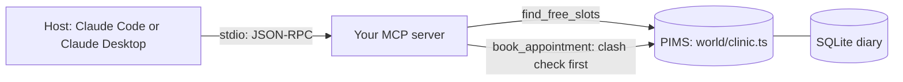

# Give the diary to the model

## The problem

Millbrook's front desk spends its time on the phone moving and booking appointments. Staff want to ask Claude
"who can see Biscuit?" and have it book the slot, with no clicking through the PIMS. The PIMS has an API, but a
model cannot use an API it has never seen, and the PIMS will double-book a vet if asked. This part builds the first
safe bridge: a stdio MCP server with one read tool and one write tool, errors the model can act on, and a real host
connected to it.

## Why it matters

Tool results and errors are the model's only view of your system. Anthropic's tool-writing guide shows the same
answer in a detailed form (206 tokens) and a concise form (72 tokens), and notes that Claude Code limits a tool
response to 25,000 tokens by default. It tells tool authors to write errors that give "specific and actionable
improvements" instead of opaque codes.
Source: [Writing effective tools for agents](https://www.anthropic.com/engineering/writing-tools-for-agents),
Anthropic Engineering, read for this course.



## Steps

| Step                              | Minutes | You produce                            | The check reads                                                                              |
| --------------------------------- | ------- | -------------------------------------- | -------------------------------------------------------------------------------------------- |
| `expose-the-diary`                | 15      | a stdio server with `find_free_slots`  | `tools/list`, a live call, stdout before any request, a slot booked behind the server's back |
| `book-an-appointment`             | 15      | `book_appointment` with a clash check  | the diary rows after each of five calls                                                      |
| `return-errors-the-model-can-fix` | 10      | errors that name the field and the fix | five planted bad calls, the free slots in the diary                                          |
| `connect-claude`                  | 10      | `.mcp.json` and Claude's answer        | the server started from your config, every time in the answer                                |

Each step's starter is the previous step's sample solution, so you can start any step fresh. To carry on with your
own code instead, copy your `server.ts` into the next step's `problem/` folder.

## Walkthrough

```bash
bun run verify expose-the-diary
```

Expect: `Done. All 8 rules pass.` once your work meets every Done when line. Before that, each FAIL line has a `Try next:`.

```bash
bun run verify book-an-appointment
```

Expect: `Done. All 7 rules pass.` once your work meets every Done when line. Before that, each FAIL line has a `Try next:`.

```bash
bun run verify return-errors-the-model-can-fix
```

Expect: `Done. All 7 rules pass.` once your work meets every Done when line. Before that, each FAIL line has a `Try next:`.

```bash
bun run verify connect-claude
```

Expect: `Done. All 6 rules pass.` once your work meets every Done when line. Before that, each FAIL line has a `Try next:`.

```bash
bun run verify part give-the-diary
```

Expect: `Part give-the-diary is done: 4/4 steps pass.` once every step passes.
