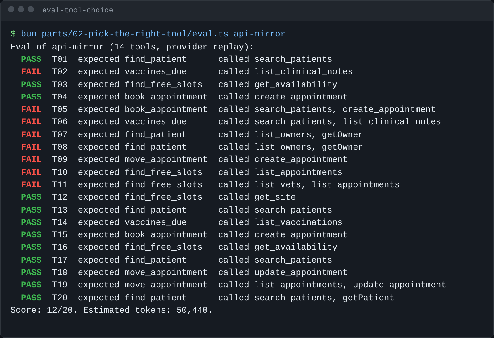

# Eval tool choice

## The problem

Many teams build their first MCP server by copying the PIMS API. Harrow Lane did too. The result is the "API
mirror": fourteen tools, one for each endpoint, such as `search_patients`, `list_owners` and `getPatient`.

It works when you call it by hand. But a model has to pick the right tool from fourteen, and it often gets it
wrong. You cannot fix that until you can measure it.

An eval is a test for a model. It gives the model the same tasks every time and scores what it does. This eval
has 20 front-desk tasks in `../../tasks.jsonl`. Each task names the tool and the inputs a good answer uses.

For example, task T02 is "When is Biscuit's booster due? Her patient id is P-0001." The right call on the API
mirror is `list_vaccinations`. The model calls `list_clinical_notes` instead. It reads every note and still does
not find the date.



## Your challenge

1. Run the eval on the API mirror and save the report as your baseline. A baseline is the score you start from,
   so you can prove later that a change helped.

```bash
bun parts/02-pick-the-right-tool/eval.ts api-mirror --save parts/02-pick-the-right-tool/01-eval-tool-choice/problem/evals/baseline.json
```

Expect: a PASS or FAIL line for each task, then `Score: 12/20.` and `Saved ...baseline.json`.

```text
Eval of api-mirror (14 tools, provider replay):
  FAIL  T02  expected vaccines_due      called list_clinical_notes
Score: 12/20. Estimated tokens: 50,440.
```

2. Open `evals/baseline.json`. Each task has the calls the model made, `pass`, and `estimatedTokens`.
3. Fill in `evals/notes.md`: the score, the worst mix-up, the wrong tool, and why you think the model chose it.

With no key, the eval plays back recorded model choices. So it is free and gives the same score every time. With
`LLM_PROVIDER` and a key in `.env`, a live model chooses, and the score can move a little between runs.

If you already know this: a task passes when one successful call used the expected tool and inputs. Look at T05.
The model called the right write tool, but with the owner's id.

## Done when

- `evals/baseline.json` holds a result for each of the 20 tasks.
- The baseline is a run of the 14-tool API mirror.
- Every pass and fail in the baseline matches the calls it recorded.
- `notes.md` gives the same score as `baseline.json`.
- `notes.md` names a task that failed in the baseline.
- `notes.md` names the wrong tool the model called in that task.
- `notes.md` says in a sentence why the model picked wrong.

```bash
bun run verify eval-tool-choice
```

Expect: `Done. All 7 rules pass.` once your work meets every Done when line. Before that, each FAIL line has a `Try next:`.

```text
Done. All 7 rules pass.
```

## If you get stuck

- `There is no recording`: for this step, run the eval on `api-mirror`, not on your server.
- Every run uses a fresh copy of the diary, so the bookings the eval makes never change your own diary.
- The solution is there after you try: `../solution/evals/notes.md`.

## Words you will use

- **Eval**: a fixed set of tasks for a model, with a score, so you can compare one design with another.
- **Baseline**: the first score, saved, so you can show that a later change made things better.
- **Replay**: playing back recorded model choices instead of calling a live model. It needs no key.
- **Token**: a small piece of text. Models read and charge by tokens, and about four characters make one.
