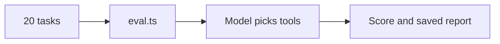

# Eval tool choice

## The problem

Harrow Lane copied its practice system's API into 14 tools. For example, ask "When is Biscuit's booster due?" and the model reads every clinical note instead of the vaccine list. Twelve of twenty front-desk tasks pass. You cannot fix that until you can measure it. An eval is a fixed set of tasks that you score.



## Watch it done

Before, the check fails on everything. After, the baseline and notes exist.

```bash
bun run verify eval-tool-choice
```

Expect: seven FAIL lines, such as `FAIL  evals/baseline.json holds a result for each of the 20 tasks`, then `0 of 7 rules pass.`

```bash
bun run verify eval-tool-choice solution
```

Expect: `Done. All 7 rules pass.`


## Your turn

1. Run the eval on the 14-tool API mirror and save the report. This saved score is your baseline, the number you start from.

```bash
bun parts/02-pick-the-right-tool/eval.ts api-mirror --save parts/02-pick-the-right-tool/01-eval-tool-choice/problem/evals/baseline.json
```

Expect: twenty PASS or FAIL lines, then `Score: 12/20. Estimated tokens: 50,440.` and `Saved`.

2. Find a failed task in the output.

```text
  FAIL  T10  expected find_free_slots   called list_appointments
```

Expect: the `expected` column names a job tool. The mirror has no tool with that name, so a match is by job.

3. Open `evals/notes.md` and fill in four lines: the score, a failed task id, the wrong tool, and one sentence on why the model chose it.

With no key, the eval replays recorded choices, so the score is the same every time.

## Do it on your work

Write 10 or more tasks for your own server, each with the tool and key inputs a good answer uses. Run them and save the score. Good looks like a number you can compare after every change.

## Done when

- `evals/baseline.json` holds a result for each of the 20 tasks.
- The baseline is a run of the 14-tool API mirror.
- Every pass and fail in the baseline matches the calls it recorded.
- `notes.md` gives the same score, names a failed task and the wrong tool, and says why in one sentence.

```bash
bun run verify eval-tool-choice
```

Expect: `Done. All 7 rules pass.`

## Solution

The after state is a saved baseline and filled-in notes. See `solution/evals/baseline.json` and `solution/evals/notes.md`.

## Go further

A task passes when one successful call used the expected tool and inputs. Look at T05: the model called the right write tool with the owner's id, so it fails.

## If you get stuck

- No recording found: run the eval on `api-mirror`, not on your own server.
- Every run uses a fresh copy of the diary, so your own diary never changes.

## Words you will use

- **Eval**: a fixed set of tasks for a model, with a score, so you can compare one design with another.
- **Baseline**: the first score, saved, so you can show that a later change helped.
- **Token**: a small piece of text. Models read and charge by tokens, and about four characters make one.
