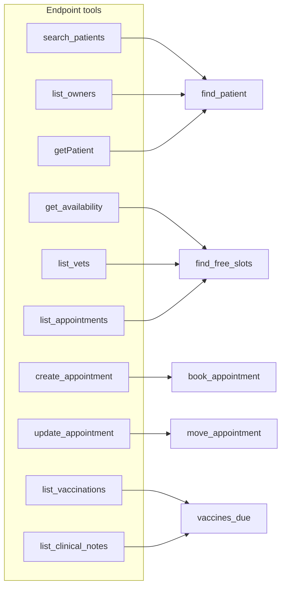

# Shape tools around jobs

## The problem

The API mirror has fourteen tools because the PIMS has fourteen endpoints. But the front desk does five jobs:
find a patient, find a free slot, book, move, and check which vaccines are due.

When tools follow endpoints, the model must plan several calls and guess between look-alike tools. Your baseline
showed it. `create_appointment` asks for an `id`, so the model booked Pepper under her owner's id.



For example, the job tool for vaccines answers for Pepper in one line, although she has two cat flu records:

```text
Pepper: Cat flu due 2026-11-24
```

## Your challenge

Your `server.ts` already has `find_free_slots` and `book_appointment` from Part 1. Add three job tools:

1. `find_patient(name?, ownerName?, ownerPhone?)`: call `clinic.findPatients(...)` and return each patient id.
2. `move_appointment(appointmentId, start, date?, vetId?)`: use the same clash check as booking. Leave the
   appointment you move out of the check, or it clashes with itself.
3. `vaccines_due(patientId)`: the latest due date of each vaccine, from `clinic.vaccinations(patientId)`.

Follow three naming rules. Name every input for what it holds: `patientId`, never `id`. Use one style for tool
names: `vaccines_due`, never `getPatient`. Start each description with what that tool does.

Then run the eval on your server and save the result:

```bash
bun parts/02-pick-the-right-tool/eval.ts parts/02-pick-the-right-tool/02-shape-tools-around-jobs/problem --save parts/02-pick-the-right-tool/02-shape-tools-around-jobs/problem/evals/designed.json
```

Expect: `Score: 19/20.` once all five tools work. T19 still fails: no tool lists a patient's appointments.

```text
  FAIL  T19  expected move_appointment  called find_patient
Score: 19/20. Estimated tokens: 43,290.
```

With no key, the eval replays recorded choices for these five tool names, so the names must match. Each recorded
call must also work on your server. With a live model, your descriptions matter too.

If you already know this: GitHub cut its default MCP tools from 102 to 52 for this reason
([github/github-mcp-server pull request 1159](https://github.com/github/github-mcp-server/pull/1159)). Add a sixth
tool for T19 and run the eval with a live model.

## Done when

- The server starts and lists its tools.
- `tools/list` has the five job tools and at most 6 tools.
- Every tool name is lower case words joined by underscores.
- Every input is named for what it holds.
- No two descriptions start with the same 8 words.
- `tools/list` gives the same order on two calls.
- Over 3 replay runs the eval scores at least 18 of 20, and at least 4 above the baseline.
- `evals/designed.json` is a saved eval run of this server that scores at least 18.

```bash
bun run verify shape-tools-around-jobs
```

Expect: `Done. All 8 rules pass.` once your work meets every Done when line. Before that, each FAIL line has a `Try next:`.

## If you get stuck

- A task fails although the model chose the right tool: look for a tool error. Your tool refused a good input.
- The message says there is no recording: one of the five tool names is spelled differently.
- The solution is there after you try: `../solution/server.ts`.

## Words you will use

- **Job tool**: a tool shaped around one task a person does. It may call several endpoints inside.
- **Endpoint tool**: a tool that copies one API endpoint, so the model must plan the calls itself.
- **Description**: the text the model reads to decide when to use a tool. Its first words matter most.
