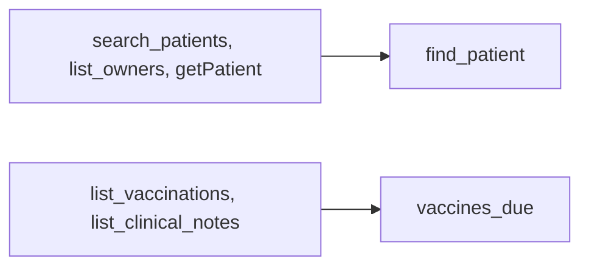

# Shape tools around jobs

## The problem

The API mirror has fourteen tools because the practice system has fourteen endpoints. The front desk does five jobs. For example, given `create_appointment`, which asks for an `id`, the model booked Pepper under her owner's id. Fewer tools, shaped like jobs, remove the guessing.



## Watch it done

```bash
bun run verify shape-tools-around-jobs
```

Expect: `FAIL  tools/list has the five job tools and at most 6 tools` and `5 of 8 rules pass.`

```bash
bun run verify shape-tools-around-jobs solution
```

Expect: `Done. All 8 rules pass.`

## Your turn

`server.ts` already has `find_free_slots` and `book_appointment`. Add three tools.

1. `find_patient(name?, ownerName?, ownerPhone?)`: call `clinic.findPatients(...)` and return each patient id.
2. `move_appointment(appointmentId, start, date?, vetId?)`: reuse the booking clash check, and leave the moved appointment out of it.
3. `vaccines_due(patientId)`: the latest due date of each vaccine, from `clinic.vaccinations(patientId)`.

Name every input for what it holds: `patientId`, never `id`. Start each description with what the tool does.

4. Run the eval on your server and save it.

```bash
bun parts/02-pick-the-right-tool/eval.ts parts/02-pick-the-right-tool/02-shape-tools-around-jobs/problem --save parts/02-pick-the-right-tool/02-shape-tools-around-jobs/problem/evals/designed.json
```

Expect: `Score: 19/20. Estimated tokens: 43,290.` Only T19 fails: `FAIL  T19  expected move_appointment  called find_patient`.

## Do it on your work

List the jobs your users do in plain words. Make one tool per job, not per endpoint. Good looks like at most six tools, and a score that beats your baseline by at least four tasks.

## Done when

- `tools/list` has the five job tools and at most 6 tools.
- Every tool name is lower case words joined by underscores.
- Every input is named for what it holds.
- No two descriptions start with the same 8 words.
- The eval scores at least 18 of 20, at least 4 above the baseline.
- `evals/designed.json` is a saved run of this server.

```bash
bun run verify shape-tools-around-jobs
```

Expect: `Done. All 8 rules pass.`

## Solution

The after state is a server with five job tools. See `solution/server.ts` and `solution/evals/designed.json`.

## Go further

Add a sixth tool that lists a patient's appointments, so T19 passes. Run it with a live model, where your descriptions matter too. GitHub cut its default MCP tools from 102 to 52 for this reason ([pull request 1159](https://github.com/github/github-mcp-server/pull/1159)).

## If you get stuck

- A task fails but the model chose the right tool: look for a tool error. Your tool refused a good input.
- No recording found: one of the five tool names is spelled differently.

## Words you will use

- **Job tool**: a tool shaped around one task a person does. It may call several endpoints inside.
- **Endpoint tool**: a tool that copies one API endpoint, so the model must plan the calls itself.
- **Description**: the text the model reads to decide when to use a tool. Its first words matter most.
