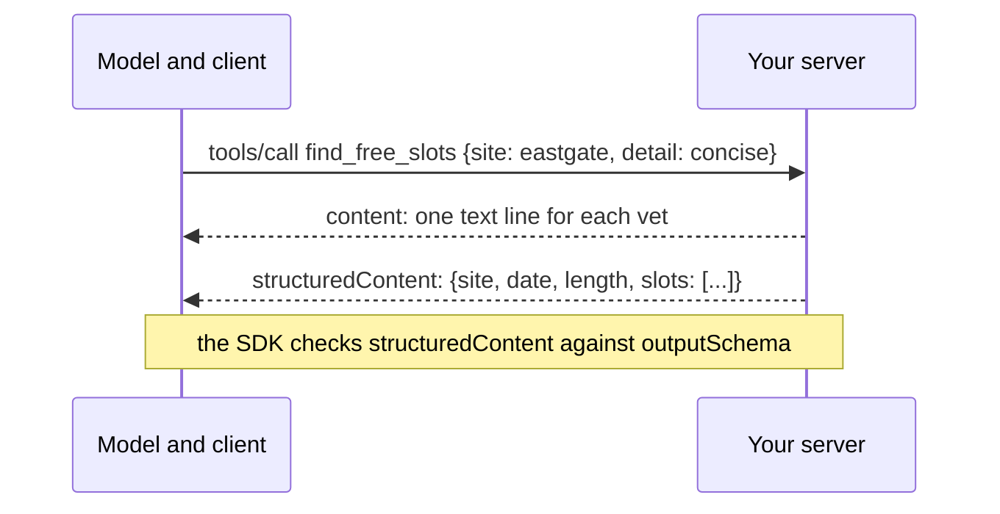

# Return structured results

## The problem

Right now `find_free_slots` and `vaccines_due` answer with text only. A model can read text, but code cannot trust
it. A client that wants to show slots as buttons has to parse a sentence. And the text has no size limit, so one
busy day can fill the model's context with times nobody asked for.

Anthropic's tool-writing guide shows the cost. One answer took 206 tokens in a detailed form and 72 tokens in a
short form ([Writing effective tools for agents](https://www.anthropic.com/engineering/writing-tools-for-agents)).

MCP lets a tool return both forms. `structuredContent` is JSON for code, checked against the tool's
`outputSchema`. The text in `content` is a short summary for the model and for clients that show only text.



For example, Eastgate has 70 free 30-minute starts on 2026-11-17. Concise gives three for each vet:

```text
Dr Rhys Evans (S-09): 08:00, 08:10, 08:20
Dr Mei Lin (S-10): 08:00, 08:10, 08:20
```

## Your challenge

1. Give `find_free_slots` an `outputSchema`: `site`, `date`, `length`, and `slots`, a list of
   `{ vetId, vetName, start }`. Return the same shape as `structuredContent`.
2. Give `vaccines_due` an `outputSchema`: `patientId`, `name`, and `vaccines`, a list of
   `{ vaccine, due, given? }`.
3. Add a `detail` input to both: `"concise"` (the default) or `"full"`. Concise slots are the first 3 for each
   vet. Concise vaccines are the latest due date of each vaccine. Full gives everything.
4. Keep a one-line text summary in `content`.

```bash
bun run try vaccines_due '{"patientId":"P-0042","detail":"full"}' --server parts/02-pick-the-right-tool/03-return-structured-results/problem
```

Expect: `Result from vaccines_due:` and both of Pepper's cat flu records once `detail` works.

```text
Result from vaccines_due:
Pepper: Cat flu due 2026-10-31; Cat flu due 2026-11-24
```

If you already know this: the SDK refuses a result that does not match `outputSchema`, as a tool error. Try
returning `length` as a string and see what the model would read.

## Done when

- The server starts and answers an MCP client.
- `find_free_slots` and `vaccines_due` both declare an `outputSchema`.
- Ten fixture calls return `structuredContent` that matches the tool's `outputSchema`.
- Every one of those results also has a text summary.
- A concise `find_free_slots` answer stays under 150 tokens (Eastgate, 2026-11-17, 30 minutes).
- A full `find_free_slots` answer lists every free slot the diary has.
- Every slot in the structured result is really free in the diary.
- `vaccines_due` gives one entry per vaccine when concise, and every record when full (Pepper).

```bash
bun run verify return-structured-results
```

Expect: `Done. All 8 rules pass.` once your work meets every Done when line. Before that, each FAIL line has a `Try next:`.

```text
Done. All 8 rules pass.
```

## If you get stuck

- Write the Zod object once and use it twice: as `outputSchema`, and as the type of what you return.
- The eval from the last step still works on this server, because the default detail is concise.
- The solution is there after you try: `../solution/server.ts`.

## Words you will use

- **Structured content**: JSON in a tool result that code can read without parsing a sentence.
- **Output schema**: the shape that structured content must have. Clients can check every result against it.
- **Concise**: the short form of an answer, with just enough for the next step.
