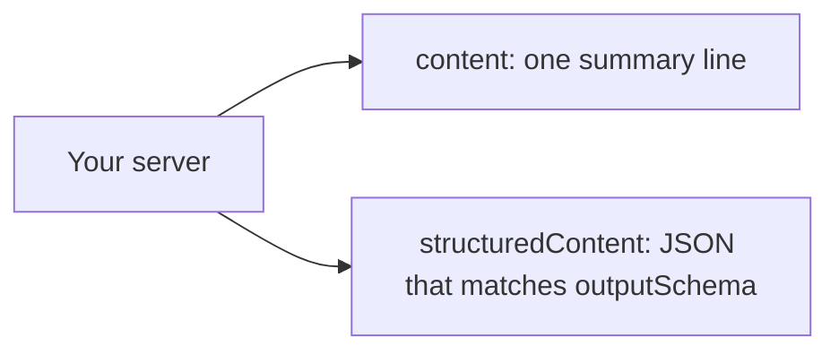

# Return structured results

## The problem

`find_free_slots` answers with text only. For example, Eastgate has 70 free starts on one day, so one busy search can flood the model with times nobody asked for. Code cannot trust a sentence either. Anthropic measured one answer at 206 tokens in a detailed form and 72 in a short form.



## Watch it done

```bash
bun run verify return-structured-results
```

Expect: `FAIL  find_free_slots and vaccines_due both declare an outputSchema` and `2 of 8 rules pass.`

```bash
bun run verify return-structured-results solution
```

Expect: `Done. All 8 rules pass.`

## Your turn

1. Give `find_free_slots` an `outputSchema` with `site`, `date`, `length` and `slots`. Each slot has `vetId`, `vetName` and `start`. Return it as `structuredContent`.
2. Give `vaccines_due` an `outputSchema` with `patientId`, `name` and `vaccines`. Each vaccine has `vaccine`, `due` and `given`.
3. Add a `detail` input to both: `concise` (the default) or `full`. Concise slots are the first 3 for each vet.
4. Keep a one-line summary in `content`.
5. Try Pepper, who has two cat flu records.

```bash
bun run try vaccines_due '{"patientId":"P-0042","detail":"full"}' --server parts/02-pick-the-right-tool/03-return-structured-results/problem
```

Expect: a result with both cat flu records, ending `Cat flu due 2026-11-24`.

## Do it on your work

Pick your busiest tool. Write its result as a small JSON shape, then add a short form as the default. Good looks like a short answer under 150 tokens and a full form on request.

## Done when

- `find_free_slots` and `vaccines_due` both declare an `outputSchema`.
- Ten fixture calls match the schema and also carry a text summary.
- A concise `find_free_slots` answer stays under 150 tokens.
- A full answer lists every free slot, and every slot is really free.
- `vaccines_due` gives one entry per vaccine when concise, and every record when full.

```bash
bun run verify return-structured-results
```

Expect: `Done. All 8 rules pass.`

## Solution

The after state has both schemas and the `detail` input. See `solution/server.ts`.

## Go further

The SDK refuses a result that does not match the schema, as a tool error. Return `length` as a string and see what the model would read.

## If you get stuck

- Write the Zod object once and use it as both `outputSchema` and the type of what you return.
- The eval from the last step still works, because the default detail is concise.

## Words you will use

- **Structured content**: JSON in a tool result that code can read without parsing a sentence.
- **Output schema**: the shape that structured content must have.
- **Concise**: the short form of an answer, with just enough for the next step.
