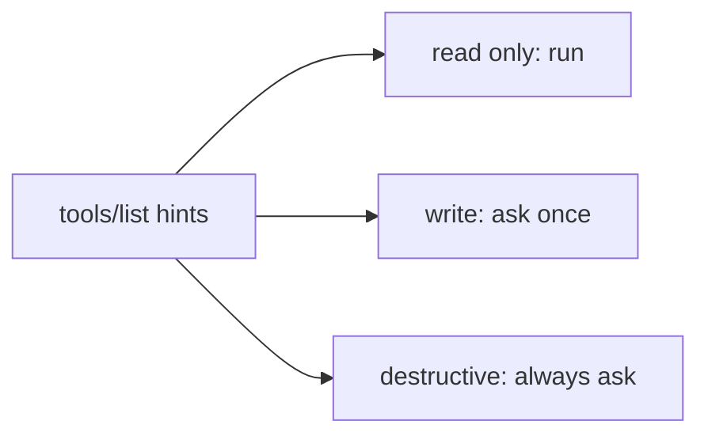

# Mark risky tools

## The problem

A host such as Claude Desktop decides when to ask a person before a tool runs. With no hints, it treats every tool as one that writes and may destroy data. For example, staff then see "Allow?" on every slot search, click yes without reading, and miss the one warning that matters.



## Watch it done

```bash
bun run verify mark-risky-tools
```

Expect: `FAIL  find_patient, find_free_slots and vaccines_due are marked read-only` and `1 of 4 rules pass.`

```bash
bun run verify mark-risky-tools solution
```

Expect: `Done. All 4 rules pass.`

## Your turn

1. Open `server.ts` and find the tool configs.
2. Add `annotations` next to `description`, as in this table.

| Tool               | readOnlyHint | destructiveHint | idempotentHint |
| ------------------ | ------------ | --------------- | -------------- |
| `find_patient`     | true         |                 |                |
| `find_free_slots`  | true         |                 |                |
| `vaccines_due`     | true         |                 |                |
| `book_appointment` | false        | false           | false          |
| `move_appointment` | false        | false           | true           |

Destructive means it deletes or overwrites what someone needs. Idempotent means calling it twice with the same inputs leaves the same result as once. Set all three on a write, because the defaults are `destructiveHint: true` and `idempotentHint: false`.

3. Run the check.

```bash
bun run verify mark-risky-tools
```

Expect: `Done. All 4 rules pass.`

## Do it on your work

List your tools and ask of each one: does it change anything, and can it be undone? Mark them the same way. Good looks like every tool carrying hints, and a person asked only for the risky ones.

## Done when

- `find_patient`, `find_free_slots` and `vaccines_due` are marked read-only.
- `book_appointment` is a write that is not destructive and not idempotent.
- `move_appointment` is a write that is not destructive and is idempotent.

## Solution

The after state has hints on all five tools. See `solution/server.ts`.

## Go further

Hints help a host that trusts you. A host should never decide on hints from an untrusted server, so keep your own checks, like the clash check in `book_appointment`. Part 3 adds `cancel_appointment`, the first destructive tool, and it asks the person itself.

## If you get stuck

- Annotations sit next to `description` and `inputSchema` in the tool config.

## Words you will use

- **Annotation**: a hint about how a tool behaves, sent in `tools/list` for the host to read.
- **Destructive**: a change that deletes or overwrites something a person needs.
- **Idempotent**: doing it twice with the same inputs has the same effect as doing it once.
