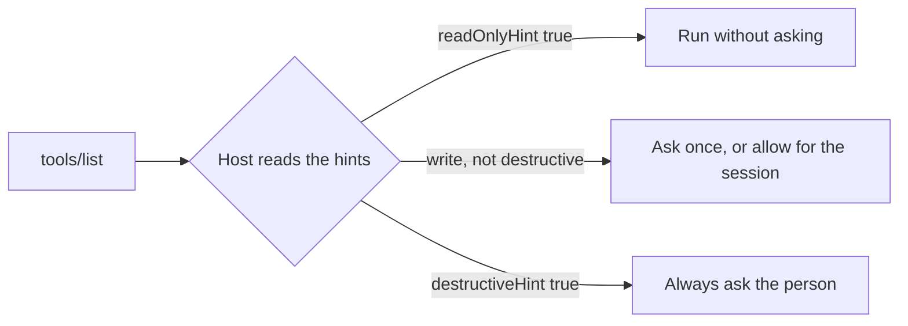

# Mark risky tools

## The problem

A host such as Claude Desktop decides when to ask a person before a tool runs. It cannot read your code, so it
reads the tool's annotations. These are hints in `tools/list` that say whether a tool changes anything.

Leave them out and the host must guess. The MCP schema's defaults are careful: a tool with no hints counts as one
that writes and may destroy data. So staff get asked "Allow?" for every slot search. They soon click yes without
reading, and then the one real warning gets missed.

The schema also warns the other way, in the `ToolAnnotations` notes of the SDK you installed: "Clients should
never make tool use decisions based on `ToolAnnotations` received from untrusted servers." Annotations help a
host that trusts you. They never replace your own checks, like the clash check in `book_appointment`.



For example, when you finish, the tools list says this about the tool that moves appointments:

```text
move_appointment  {"readOnlyHint":false,"destructiveHint":false,"idempotentHint":true}
```

## Your challenge

Add `annotations` to each tool config in `server.ts`, as this table says:

| Tool               | readOnlyHint | destructiveHint | idempotentHint | Why                                            |
| ------------------ | ------------ | --------------- | -------------- | ---------------------------------------------- |
| `find_patient`     | true         |                 |                | it only reads                                  |
| `find_free_slots`  | true         |                 |                | it only reads                                  |
| `vaccines_due`     | true         |                 |                | it only reads                                  |
| `book_appointment` | false        | false           | false          | it adds a row; booking twice adds two          |
| `move_appointment` | false        | false           | true           | moving to the same time twice is the same move |

Destructive means it deletes or overwrites what someone needs. Idempotent means calling it twice with the same
inputs leaves the same result as calling it once. Set all three hints on a write, because the defaults are
`destructiveHint: true` and `idempotentHint: false`.

If you already know this: Part 3 adds `cancel_appointment`, the first destructive tool. It also asks the person
itself, so it stays safe on a host that ignores hints.

## Done when

- The server starts and lists its tools.
- `find_patient`, `find_free_slots` and `vaccines_due` are marked read-only.
- `book_appointment` is a write that is not destructive and not idempotent.
- `move_appointment` is a write that is not destructive and is idempotent.

```bash
bun run verify mark-risky-tools
```

Expect: `Done. All 4 rules pass.` once your work meets every Done when line. Before that, each FAIL line has a `Try next:`.

```text
Done. All 4 rules pass.
```

## If you get stuck

- Annotations sit next to `description` and `inputSchema` in the tool config.
- The solution is there after you try: `../solution/server.ts`.

## Words you will use

- **Annotation**: a hint about how a tool behaves, sent in `tools/list` for the host to read.
- **Destructive**: a change that deletes or overwrites something a person needs.
- **Idempotent**: doing it twice with the same inputs has the same effect as doing it once.
