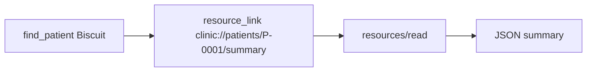

# Add records as resources

## The problem

A patient's summary is the same every time, and a person often wants to see it, not only the model. For example, making the model call a tool for each of 600 patients is slow. A resource is a record with an address, a URI, that the host can read and show without a model call.



## Watch it done

```bash
bun run verify add-records-as-resources
```

Expect: `FAIL  resources/templates/list has clinic://patients/{patientId}/summary` and `1 of 7 rules pass.`

```bash
bun run verify add-records-as-resources solution
```

Expect: `Done. All 7 rules pass.`

## Your turn

1. Register the template `clinic://patients/{patientId}/summary` with `server.registerResource(...)` and `new ResourceTemplate(...)`. A template is a URI with a blank, so one template serves all patients.
2. Return JSON with `patientId`, `name`, `species`, `breed`, `homeSite`, `alerts` and `vaccinesDue`. Reuse `latestDueDates`. Leave owner phone and email out.
3. When `clinic.patient(...)` finds nobody, throw `new ResourceNotFoundError(uri.toString())`. The client gets error -32602.
4. Make `find_patient` return a `resource_link` to each summary, after the text line.
5. Register a prompt `prepare_discharge_note(patientId)`. A prompt is a ready-made request a person picks in the host. Its message names the pet.

```bash
bun run verify add-records-as-resources
```

Expect: `Done. All 7 rules pass.`

## Do it on your work

Pick one record your users look up often. Share it as a resource and leave out anything private. Good looks like a host that can show it with no model call.

## Done when

- `resources/templates/list` has `clinic://patients/{patientId}/summary`.
- Biscuit's summary has species, alerts and vaccines due, and no owner phone or email.
- An unknown patient id gets error -32602.
- `find_patient` returns a `resource_link`.
- `prompts/list` has `prepare_discharge_note`, and its messages name Biscuit.

## Solution

The after state has the template, the link and the prompt. See `solution/server.ts`.

## Go further

List results carry `ttlMs` and `cacheScope`. The SDK sends `ttlMs: 0` and `private` unless you set a hint. Keep that for patient data.

## If you get stuck

- `ResourceTemplate` and `ResourceNotFoundError` come from `@modelcontextprotocol/server`.
- The read callback gets the URI and the filled blanks, such as `patientId` set to `P-0001`.

## Words you will use

- **Resource**: a record the server shares by URI, for the host to read and show.
- **Resource template**: a URI with a blank, such as `{patientId}`, that stands for many resources.
- **Resource link**: a pointer to a resource inside a tool result.
- **Prompt**: a ready-made request, with inputs, that a person picks in the host.
