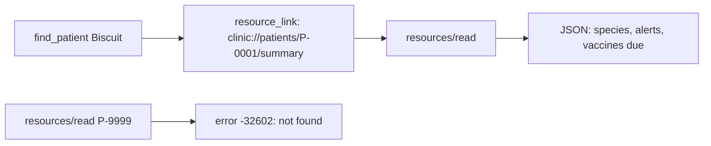

# Add records as resources

## The problem

Tools are for actions the model chooses. But some things are records, not actions. A patient's summary is the
same every time you look, and the person often wants to see it, not only the model.

MCP has a second building block for that: a resource. A resource is a record with a URI, an address like a web
link. The host can read it, show it, or attach it to a chat, without asking the model to call a tool.

A resource template is a URI with a blank to fill in. One template serves all 600 patients.



For example, reading Biscuit's summary gives this JSON. It has no owner phone or email:

```text
{ "patientId": "P-0001", "name": "Biscuit", "species": "dog", "breed": "Labrador",
  "homeSite": "millbrook", "alerts": "", "vaccinesDue": [{ "vaccine": "DHP", "due": "2026-11-19" }, ...] }
```

## Your challenge

1. Register a resource template `clinic://patients/{patientId}/summary` with `server.registerResource(...)`
   and `new ResourceTemplate(...)`. Return JSON with `patientId`, `name`, `species`, `breed`, `homeSite`,
   `alerts` and `vaccinesDue`. Reuse `latestDueDates` from `vaccines_due`.
2. When `clinic.patient(...)` finds nobody, throw `new ResourceNotFoundError(uri.toString())`. The client then
   gets error -32602. This code changed in the 2026-07-28 spec. Older servers sent -32002.
3. Make `find_patient` return a `resource_link` to each patient's summary, after the text line.
4. Register a prompt `prepare_discharge_note(patientId)`. A prompt is a ready-made request that a person picks
   from a menu in the host. Its message should name the pet.

Leave owner contact details out of the summary. A host may show a resource to anyone at the desk, or keep it in a
chat log. The summary only needs what the desk uses.

If you already know this: list results in the 2026-07-28 spec carry `ttlMs` and `cacheScope`. The SDK sends
`ttlMs: 0` and `private` unless you set a cache hint. Keep it that way for patient data.

## Done when

- The server starts and answers an MCP client.
- `resources/templates/list` has `clinic://patients/{patientId}/summary`.
- Reading Biscuit's summary gives JSON with species, alerts and the vaccines due.
- The summary holds no owner phone number or email.
- An unknown patient id gets error -32602.
- `find_patient` for Biscuit returns a `resource_link` to her summary.
- `prompts/list` has `prepare_discharge_note`, and its messages name Biscuit.

```bash
bun run verify add-records-as-resources
```

Expect: `Done. All 7 rules pass.` once your work meets every Done when line. Before that, each FAIL line has a `Try next:`.

```text
Done. All 7 rules pass.
```

## If you get stuck

- `ResourceTemplate` and `ResourceNotFoundError` come from `@modelcontextprotocol/server`.
- The read callback gets the URI and the filled-in blanks, for example `patientId` set to `P-0001`.
- The solution is there after you try: `../solution/server.ts`.

## Words you will use

- **Resource**: a record the server shares by URI, for the host to read and show.
- **Resource template**: a URI with a blank, such as `{patientId}`, that stands for many resources.
- **Resource link**: a pointer to a resource inside a tool result, so the host can open the record.
- **Prompt**: a ready-made request, with inputs, that a person picks in the host.
