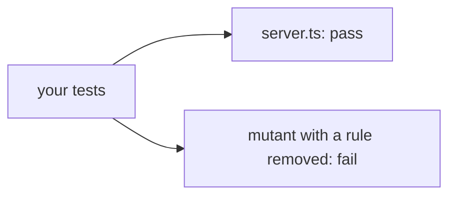

# Test the server

## The problem

Next month a colleague edits `server.ts` and nobody runs the course checks. For example, if the clash check breaks, Dr Reyes is double-booked and two owners arrive for one slot. Your server needs its own tests. A test that checks nothing also passes, so the check breaks your server on purpose, which is mutation testing, and your tests must notice.



## Watch it done

```bash
bun run verify test-the-server
```

Expect: `FAIL  test/ has at least 4 tests, and they all pass on your server` and `0 of 3 rules pass.`

```bash
bun run verify test-the-server solution
```

Expect: `Done. All 3 rules pass.`


## Your turn

`test/server.test.ts` joins a client to `createServer()` with `InMemoryTransport` and has two tests. Add three.

1. Booking a free slot works. Use `freeSlotForDrEvans()` so it is true on any diary.
2. Booking the same time twice is refused with `isError: true`.
3. Booking patient `P-9999` is refused with `isError: true`.

```bash
bun test parts/02-pick-the-right-tool/06-test-the-server/problem/test
```

Expect: `5 pass` and `0 fail`.

Keep the names `findClash` and `unknownPatientError` in `server.ts`, because the check breaks those two.

## Do it on your work

Write one test for the rule that would hurt most if it broke. Remove that rule once and watch the test fail. Good looks like a red test, then green again when you put the rule back.

## Done when

- `test/` has at least 4 tests, and they all pass.
- Your tests fail when the clash check is removed.
- Your tests fail when the unknown-patient check is removed.

```bash
bun run verify test-the-server
```

Expect: `Done. All 3 rules pass.`

## Solution

The after state is a test file with five tests. See `solution/test/server.test.ts`.

## Go further

The tests share one diary, in the order they run. Ask for a free slot in each test, so no test depends on another.

## If you get stuck

- The tests use a scratch copy of the diary, so your own diary stays as it is.
- `expect(result.isError).toBe(true)` catches a missing refusal.

## Words you will use

- **In-process client**: a client and a server joined inside one program, so a test needs no network.
- **Mutant**: a copy of your code with one rule broken on purpose.
- **Mutation testing**: running your tests on mutants. A good suite fails on each one.
