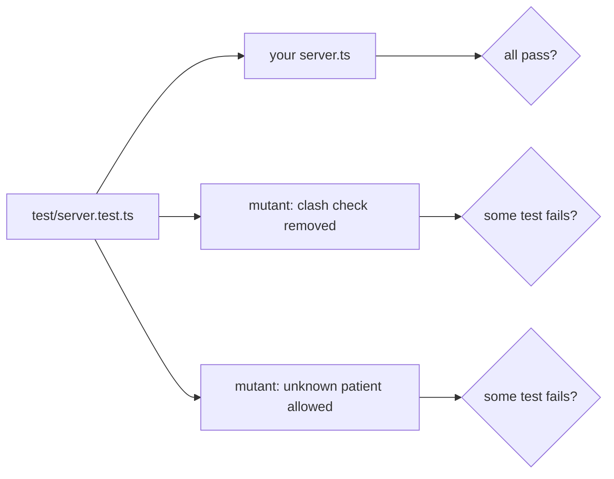
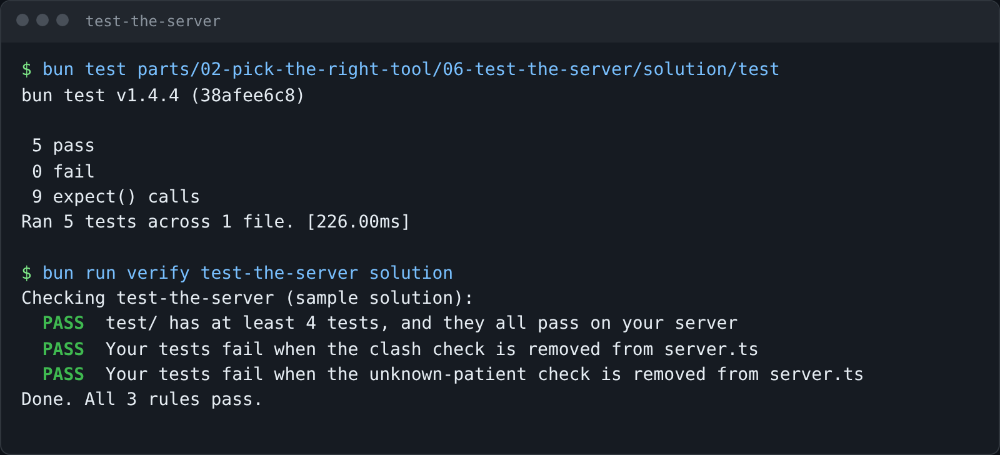

# Test the server

## The problem

Every step so far was checked by this course. Next month a colleague changes `server.ts`, and nobody runs the
course checks. If the clash check breaks, Dr Reyes gets double-booked, and nobody notices until two owners arrive.

Your server needs its own tests, in your repo, that run in a second. The SDK can connect a client to your server
inside one process: no socket, no stdio, no model. So a test calls a tool the way Claude does and checks the
answer.

But passing tests prove little. A test that checks nothing also passes. So the check here breaks your server on
purpose, then runs your tests again. This is mutation testing. Each broken copy is a mutant, and a good test suite
fails on every mutant.



For example, the first mutant adds one line to the clash function in a copy of your server. A test that books the
same time twice must now fail:

```text
function findClash(booking, date, movingId) {
  return undefined;
```



## Your challenge

`test/server.test.ts` already connects a client to `createServer()` with `InMemoryTransport`, and has two tests.
Add tests until a broken server fails at least one:

1. Booking a free slot works. Use `freeSlotForDrEvans()` so the test is true on any diary.
2. Booking the same time twice is refused with `isError: true`.
3. Booking patient `P-9999` is refused with `isError: true`.

```bash
bun test parts/02-pick-the-right-tool/06-test-the-server/problem/test
```

Expect: `5 pass` and `0 fail` once your three tests are in.

```text
 5 pass
 0 fail
Ran 5 tests across 1 file.
```

Keep the names `findClash` and `unknownPatientError` in `server.ts`, because the check breaks those two.

If you already know this: the tests share one diary, in the order they run. Ask the server for a free slot in
each test, as `freeSlotForDrEvans()` does, so no test depends on another.

## Done when

- `test/` has at least 4 tests, and they all pass on your server.
- Your tests fail when the clash check is removed from `server.ts`.
- Your tests fail when the unknown-patient check is removed from `server.ts`.

```bash
bun run verify test-the-server
```

Expect: `Done. All 3 rules pass.` once your work meets every Done when line. Before that, each FAIL line has a `Try next:`.

```text
Done. All 3 rules pass.
```

## If you get stuck

- The tests use a scratch copy of the diary in your system's temp folder. Your own diary stays as it is.
- `expect(result.isError).toBe(true)` is the line that catches a missing refusal.
- The solution is there after you try: `../solution/test/server.test.ts`.

## Words you will use

- **In-process client**: a client and a server joined inside one program, so a test needs no network.
- **Mutant**: a copy of your code with one rule broken on purpose.
- **Mutation testing**: running your tests on mutants. A good suite fails on each one.
