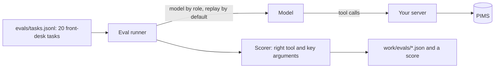

# Pick the right tool

## The problem

The first version of a clinic server usually mirrors the PIMS API: one tool per endpoint, fourteen in all. The model
confuses `search_patients` with `list_owners`, books under the owner's id, and reads every note to find one vaccine
date. Each wrong call costs tokens and a receptionist's trust. In this part you measure tool choice on twenty
front-desk tasks, redesign the tools around jobs, and prove the score went up.

## Why it matters

GitHub cut the default toolset of its own MCP server from 102 tools and 64.6k tokens to 52 tools and 30.3k tokens
([github/github-mcp-server pull request 1159](https://github.com/github/github-mcp-server/pull/1159), "Adding default
toolset grouping"). Anthropic reports that tool use examples raised accuracy on complex parameters from 72% to 90% in
its internal testing, and that with its Tool Search Tool an MCP evaluation rose from 49% to 74%
([Introducing advanced tool use](https://www.anthropic.com/engineering/advanced-tool-use)). Tool design is measurable.



## Steps

| Step | Minutes | You produce | The check reads |
|---|---|---|---|
| `eval-tool-choice` | 15 | a baseline score for the 14-tool "API mirror" server | `evals/baseline.json`: per task tool, arguments, pass or fail, tokens |
| `shape-tools-around-jobs` | 15 | 5 job tools: `find_patient`, `find_free_slots`, `book_appointment`, `move_appointment`, `vaccines_due` | `tools/list` (at most 6 tools, name pattern, distinct descriptions, stable order) and the eval score, at least 18 of 20 and 4 above baseline, over 3 replay runs |
| `return-structured-results` | 10 | `outputSchema` and `structuredContent`, plus a `concise` or `full` detail argument | 10 fixture calls validated against `outputSchema`; concise answer under 150 tokens; text still present |
| `mark-risky-tools` | 5 | tool annotations: read-only, idempotent, destructive | annotations per tool against the table in the step README |
| `add-records-as-resources` | 10 | a `clinic://patients/{id}/summary` resource template, a `resource_link` from `find_patient`, one prompt | `resources/templates/list`, `resources/read` on a fixture id, error `-32602` on an unknown id |
| `test-the-server` | 10 | `test/server.test.ts` with an in-process client and at least 4 tests | `bun test` passes, then fails against a mutated server with the clash check removed |

Total: 65 minutes. Models come from `config/models.ts` by role; replay is the default, so the eval runs with no key.

## Walkthrough

TODO(part session): one `bun run verify <step-name>` per step, each with its `Expect:` line.

```bash
bun run verify part pick-the-right-tool
```

Expect: `Part pick-the-right-tool is done: 6/6 steps pass.` once the part session has built the steps.
