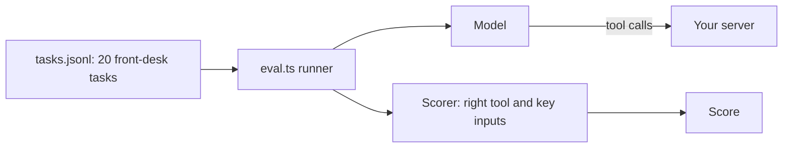

# Pick the right tool

## After this part you can

Measure how well a model picks your tools, then redesign them around jobs and prove the score went up.

## You leave with

A server with five job tools, a saved baseline and a saved designed score, short structured answers, and your own tests.

## The problem

The first version of a clinic server often copies the practice system's API, one tool for each endpoint. With fourteen look-alike tools, the model books under the owner's id and reads every note to find one vaccine date. GitHub cut its own MCP server from 102 default tools to 52, and its tool descriptions from 64.6k tokens to 30.3k ([pull request 1159](https://github.com/github/github-mcp-server/pull/1159)). A token is a small piece of text that models count and charge by.



## Steps

| Step                        | You produce                                                                                            | The check reads                                                                    |
| --------------------------- | ------------------------------------------------------------------------------------------------------ | ---------------------------------------------------------------------------------- |
| `eval-tool-choice`          | a baseline score for the 14-tool API mirror, and notes on its worst mix-up                             | `evals/baseline.json` re-scored from its own calls, and `evals/notes.md`           |
| `shape-tools-around-jobs`   | 5 job tools: `find_patient`, `find_free_slots`, `book_appointment`, `move_appointment`, `vaccines_due` | `tools/list` and the eval score, at least 18 of 20 and 4 above baseline            |
| `return-structured-results` | `outputSchema` and `structuredContent`, plus a `concise` or `full` detail input                        | 10 fixture calls checked against the schema, and a concise answer that stays short |
| `mark-risky-tools`          | tool annotations: read-only, idempotent, destructive                                                   | annotations per tool                                                               |
| `add-records-as-resources`  | a patient summary resource template, a `resource_link` from `find_patient`, a prompt                   | `resources/read`, no owner contact, error -32602 on an unknown id                  |
| `test-the-server`           | `test/server.test.ts` with an in-process client and at least 4 tests                                   | `bun test` passes, then fails on two mutants                                       |

## Watch and read

| Kind  | Title                                                            | Author                                  | Why                                                                    | Link                                                                             |
| ----- | ---------------------------------------------------------------- | --------------------------------------- | ---------------------------------------------------------------------- | -------------------------------------------------------------------------------- |
| video | Building Agents with Model Context Protocol, full workshop       | Mahesh Murag, Anthropic, at AI Engineer | The tools, resources and prompts blocks from the people who built them | https://www.youtube.com/watch?v=kQmXtrmQ5Zg                                      |
| video | Your MCP server is bad, and you should feel bad                  | Jeremiah Lowin, at AI Engineer          | Why endpoint-shaped tools fail, and what to do instead                 | https://www.youtube.com/watch?v=96G7FLab8xc                                      |
| read  | Writing effective tools for agents, with agents                  | Anthropic Engineering                   | The eval loop and the tool rules this part follows                     | https://www.anthropic.com/engineering/writing-tools-for-agents                   |
| read  | Tool Annotations as Risk Vocabulary: What Hints Can and Can't Do | MCP maintainers blog                    | What the hints can say, and why a host must not trust them blindly     | https://blog.modelcontextprotocol.io/posts/2026-03-16-tool-annotations/          |
| read  | Server Instructions: Giving LLMs a user manual for your server   | MCP maintainers blog                    | A cheap way to guide a model across many tools                         | https://blog.modelcontextprotocol.io/posts/2025-11-03-using-server-instructions/ |

## Project

Take one real server or API you use. Write 10 tasks, run an eval on its current tools, and save the score. Cut it to the tools that match real jobs, mark the risky ones, and run the eval again. You are done when the second score beats the first and a test fails if a key rule is removed.

## Walkthrough

Run the eval on the API mirror and save your baseline, then check each step as you finish it:

```bash
bun parts/02-pick-the-right-tool/eval.ts api-mirror --save parts/02-pick-the-right-tool/01-eval-tool-choice/problem/evals/baseline.json
```

Expect: twenty PASS or FAIL lines, then `Score: 12/20. Estimated tokens: 50,440.` and `Saved`.

```bash
bun run verify part pick-the-right-tool
```

Expect: `Part pick-the-right-tool is done: 6/6 steps pass.` once every step passes.

Each role gets its model from `config/models.ts`. Replay is the default, so the eval runs with no key. Each step's starter is the sample solution of the step before it. To keep your own code, copy your `server.ts` into the next step's `problem/` folder.

## Why it matters

For example, Anthropic found that tool-use examples raised accuracy on complex inputs from 72% to 90%. Its Tool Search Tool raised one MCP eval from 49% to 74% ([Introducing advanced tool use](https://www.anthropic.com/engineering/advanced-tool-use)). So you can measure tool design, and you can improve it. The same 20 tasks score 12 on the API mirror and 19 on your five job tools.

## Assignment

Hand in a server the model uses well, with proof, in your repo: `evals/baseline.json` and `evals/designed.json` (both written by the eval, never by hand), your `server.ts`, and `test/server.test.ts`. The rubric is yes or no:

1. Does `shape-tools-around-jobs` pass, with at least 18 of 20 and 4 above the baseline?
2. Does every pass and fail in both eval files match the calls it recorded?
3. Does `test-the-server` pass?
4. Does `add-records-as-resources` pass, with no owner contact in the summary?

For a stretch, write 5 new tasks in `evals/holdout.jsonl` and run them with a live model.

## Finished

You now have a server the model uses well, and the numbers to prove it. The next part, open-the-server-safely, serves this server over HTTP, adds tokens and roles, and makes cancelling wait for a person to say yes.
