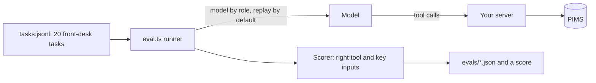

# Pick the right tool

## The problem

The first version of a clinic server often copies the PIMS API. It has one tool for each endpoint, fourteen tools in
all. With so many similar tools, the model makes mistakes:

- it mixes up `search_patients` and `list_owners`;
- it books under the owner's id, not the patient's id;
- it reads every note to find one vaccine date.

Each wrong call costs tokens and a receptionist's trust. A token here is a small piece of text; models count their
input and cost in tokens.

For example, Ola asks "When is Biscuit's booster due?". With the copied API, the model may call `list_owners` first
and then read all of Biscuit's notes. With a tool shaped around the job, it calls `vaccines_due` once with
`{"patientId":"P-0001"}`. The answer is one line: Biscuit with the two vaccines and their due days.

In this part you measure how well the model picks tools on twenty front-desk tasks. This test is called an eval.
Then you redesign the tools around jobs, and you prove the score went up. You also make the answers short and
structured, and mark which tools change the diary. Last, you share records as resources and write tests that
catch a broken server.

## Why it matters

Fewer, clearer tools work better, and the numbers show it. GitHub cut the default tools of its own MCP server from
102 tools to 52. The tool descriptions went from 64.6k tokens to 30.3k tokens, a 53% cut
([github/github-mcp-server pull request 1159](https://github.com/github/github-mcp-server/pull/1159), "Adding default
toolset grouping").

Anthropic tested this inside the company too. Showing the model examples of tool use raised accuracy on complex
inputs from 72% to 90%. With its Tool Search Tool, one MCP eval rose from 49% to 74%
([Introducing advanced tool use](https://www.anthropic.com/engineering/advanced-tool-use)). So you can measure tool
design, and you can improve it.

The diagram shows how the eval runs. A runner gives each task to the model. The model calls your server. A scorer
checks the tool and the key inputs, and writes a score.



For example, the same twenty tasks score very differently on the two servers you meet in this part:

```text
API mirror, 14 endpoint tools:  Score: 12/20. Estimated tokens: 50,440.
Your server, 5 job tools:       Score: 19/20. Estimated tokens: 43,290.
```

## Steps

| Step                        | Minutes | You produce                                                                                                  | The check reads                                                                                                                                                   |
| --------------------------- | ------- | ------------------------------------------------------------------------------------------------------------ | ----------------------------------------------------------------------------------------------------------------------------------------------------------------- |
| `eval-tool-choice`          | 15      | a baseline score for the 14-tool "API mirror" server, and notes on its worst mix-up                          | `evals/baseline.json`: per task the calls, pass or fail, tokens, re-scored from its own calls; `evals/notes.md`                                                   |
| `shape-tools-around-jobs`   | 15      | 5 job tools: `find_patient`, `find_free_slots`, `book_appointment`, `move_appointment`, `vaccines_due`       | `tools/list` (at most 6 tools, names, inputs, distinct descriptions, stable order) and the eval score, at least 18 of 20 and 4 above baseline, over 3 replay runs |
| `return-structured-results` | 10      | `outputSchema` and `structuredContent`, plus a `concise` or `full` detail input                              | 10 fixture calls checked against `outputSchema`; concise answer under 150 tokens; full answer matches the diary; text still present                               |
| `mark-risky-tools`          | 5       | tool annotations: read-only, idempotent, destructive                                                         | annotations per tool against the table in the step README                                                                                                         |
| `add-records-as-resources`  | 10      | a `clinic://patients/{patientId}/summary` resource template, a `resource_link` from `find_patient`, a prompt | `resources/templates/list`, `resources/read` on a fixture id, no owner contact, error `-32602` on an unknown id, the prompt                                       |
| `test-the-server`           | 10      | `test/server.test.ts` with an in-process client and at least 4 tests                                         | `bun test` passes, then fails against two mutants: clash check removed, unknown patient allowed                                                                   |

Each role gets its model from `config/models.ts`. Replay is the default, so the eval runs with no
key. The eval kit sits in this folder: `eval.ts`, `tasks.jsonl`, the `api-mirror.ts` server, and the two
recordings it plays back.

Each step's starter is the sample solution of the step before it, so you can start any step fresh. To keep your own
code, copy your `server.ts` into the next step's `problem/` folder.

## Walkthrough

Run the eval on the API mirror and save your baseline:

```bash
bun parts/02-pick-the-right-tool/eval.ts api-mirror --save parts/02-pick-the-right-tool/01-eval-tool-choice/problem/evals/baseline.json
```

Expect: twenty PASS or FAIL lines, then `Score: 12/20. Estimated tokens: 50,440.` and `Saved ...baseline.json`.

```text
  FAIL  T02  expected vaccines_due      called list_clinical_notes
Score: 12/20. Estimated tokens: 50,440.
```

Then check each step as you finish it. Before a step is done, each FAIL line has a Try next line.

```bash
bun run verify eval-tool-choice
```

Expect: `Done. All 7 rules pass.` once your notes are filled in.

```text
Done. All 7 rules pass.
```

Run the same eval on your job tools and save it as the designed score:

```bash
bun parts/02-pick-the-right-tool/eval.ts parts/02-pick-the-right-tool/02-shape-tools-around-jobs/problem --save parts/02-pick-the-right-tool/02-shape-tools-around-jobs/problem/evals/designed.json
```

Expect: `Score: 19/20.` once the five job tools work. Only T19 fails: no tool lists a patient's appointments.

```text
  FAIL  T19  expected move_appointment  called find_patient
Score: 19/20. Estimated tokens: 43,290.
```

```bash
bun run verify shape-tools-around-jobs
```

Expect: `Done. All 8 rules pass.` once your work meets every Done when line.

```text
Done. All 8 rules pass.
```

```bash
bun run verify return-structured-results
```

Expect: `Done. All 8 rules pass.` once your work meets every Done when line.

```text
Done. All 8 rules pass.
```

```bash
bun run verify mark-risky-tools
```

Expect: `Done. All 4 rules pass.` once your work meets every Done when line.

```text
Done. All 4 rules pass.
```

```bash
bun run verify add-records-as-resources
```

Expect: `Done. All 7 rules pass.` once your work meets every Done when line.

```text
Done. All 7 rules pass.
```

```bash
bun test parts/02-pick-the-right-tool/06-test-the-server/problem/test
```

Expect: `0 fail` and at least `4 pass` once your tests are in.

```text
 5 pass
 0 fail
```

```bash
bun run verify test-the-server
```

Expect: `Done. All 3 rules pass.` once your tests fail on both mutants.

```text
Done. All 3 rules pass.
```

```bash
bun run verify part pick-the-right-tool
```

Expect: `Part pick-the-right-tool is done: 6/6 steps pass.` once every step passes.

```text
Part pick-the-right-tool:
  PASS   eval-tool-choice  (7/7 rules)
  PASS   shape-tools-around-jobs  (8/8 rules)
  PASS   return-structured-results  (8/8 rules)
  PASS   mark-risky-tools  (4/4 rules)
  PASS   add-records-as-resources  (7/7 rules)
  PASS   test-the-server  (3/3 rules)
Part pick-the-right-tool is done: 6/6 steps pass.
```

## Assignment

The problem: a 14-tool server built from the API scores 12 of 20 on the front-desk tasks. Hand in a server the
model uses well, with proof.

What you hand in, in your repo:

- `evals/baseline.json` and `evals/designed.json`, both written by the eval, never by hand;
- your `server.ts` with the five job tools;
- `test/server.test.ts`.

The rubric. Every line is yes or no:

1. Does `bun run verify shape-tools-around-jobs` pass, with at least 18 of 20 and at least 4 above the baseline?
2. Does every pass and fail in both eval files match the calls they recorded?
3. Does `bun run verify test-the-server` pass, so your tests fail on both mutants?
4. Does `bun run verify add-records-as-resources` pass, with no owner contact in the summary?

Extension for advanced learners: write 5 new tasks of your own in `evals/holdout.jsonl`, in the same shape as
`tasks.jsonl`. Run them with a live model. Does the designed server still pass at least 4 of 5?

## Finished

You now have a server the model uses well, and the numbers to prove it. For example, the same 20 tasks went from
12 of 20 on the API mirror to 19 of 20 on your five job tools. Answers are short and structured, and each tool
says whether it changes the diary. Patient summaries are resources with no owner contact details. Your own tests
catch a missing clash check.

The next part, open-the-server-safely, takes this server off one laptop. It serves it over HTTP, adds tokens and
roles, and makes cancelling wait for a person to say yes.
