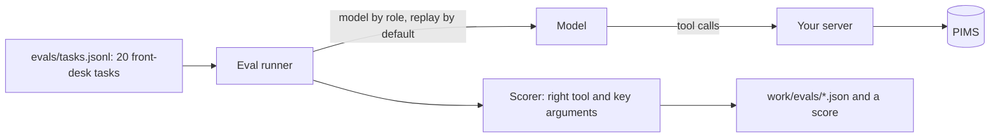

# Pick the right tool

## The problem

The first version of a clinic server often copies the PIMS API. It has one tool for each endpoint, fourteen tools in
all. With so many similar tools, the model makes mistakes:

- it mixes up `search_patients` and `list_owners`;
- it books under the owner's id, not the patient's id;
- it reads every note to find one vaccine date.

Each wrong call costs tokens and a receptionist's trust. A token here is a small piece of text; models count their
input and cost in tokens.

For example, Ola asks "When is Biscuit's booster due?". With the copied API, the model may call `list_owners` first
and then read all of Biscuit's notes. With a tool shaped around the job, it calls `vaccines_due` once with
`{"patientId":"P-0001"}`. The answer is one line: `Biscuit: DHP due 2026-11-19; Lepto due 2026-11-19`.

In this part you measure how well the model picks tools on twenty front-desk tasks. This test is called an eval.
Then you redesign the tools around jobs, and you prove the score went up.

## Why it matters

Fewer, clearer tools work better, and the numbers show it. GitHub cut the default tools of its own MCP server from
102 tools to 52. The tool descriptions went from 64.6k tokens to 30.3k tokens
([github/github-mcp-server pull request 1159](https://github.com/github/github-mcp-server/pull/1159), "Adding default
toolset grouping").

Anthropic tested this inside the company too. Showing the model examples of tool use raised accuracy on complex
inputs from 72% to 90%. With its Tool Search Tool, one MCP eval rose from 49% to 74%
([Introducing advanced tool use](https://www.anthropic.com/engineering/advanced-tool-use)). So you can measure tool
design, and you can improve it.

The diagram shows how the eval runs. A runner gives each task to the model. The model calls your server. A scorer
checks the tool and the key inputs, and writes a score.



## Steps

| Step                        | Minutes | You produce                                                                                             | The check reads                                                                                                                                                  |
| --------------------------- | ------- | ------------------------------------------------------------------------------------------------------- | ---------------------------------------------------------------------------------------------------------------------------------------------------------------- |
| `eval-tool-choice`          | 15      | a baseline score for the 14-tool "API mirror" server                                                    | `evals/baseline.json`: per task tool, arguments, pass or fail, tokens                                                                                            |
| `shape-tools-around-jobs`   | 15      | 5 job tools: `find_patient`, `find_free_slots`, `book_appointment`, `move_appointment`, `vaccines_due`  | `tools/list` (at most 6 tools, name pattern, distinct descriptions, stable order) and the eval score, at least 18 of 20 and 4 above baseline, over 3 replay runs |
| `return-structured-results` | 10      | `outputSchema` and `structuredContent`, plus a `concise` or `full` detail argument                      | 10 fixture calls validated against `outputSchema`; concise answer under 150 tokens; text still present                                                           |
| `mark-risky-tools`          | 5       | tool annotations: read-only, idempotent, destructive                                                    | annotations per tool against the table in the step README                                                                                                        |
| `add-records-as-resources`  | 10      | a `clinic://patients/{id}/summary` resource template, a `resource_link` from `find_patient`, one prompt | `resources/templates/list`, `resources/read` on a fixture id, error `-32602` on an unknown id                                                                    |
| `test-the-server`           | 10      | `test/server.test.ts` with an in-process client and at least 4 tests                                    | `bun test` passes, then fails against a mutated server with the clash check removed                                                                              |

Total: 65 minutes. Each role gets its model from `config/models.ts`. Replay is the default, so the eval runs with no
key.

## Walkthrough

TODO(part session): one `bun run verify <step-name>` per step, each with its `Expect:` line.

```bash
bun run verify part pick-the-right-tool
```

Expect: `Part pick-the-right-tool is done: 6/6 steps pass.` once the part session has built the steps.

A later build session adds the steps of this part. Until then, the table above shows what each step asks of you.
