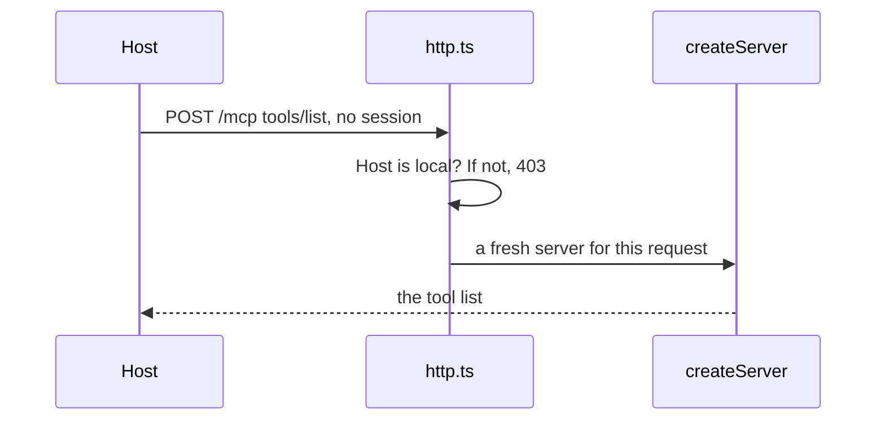

# Serve over HTTP

## The problem

Your server talks over stdio, which reaches one host on one laptop. Harrow Lane has three sites and twelve staff, so every desk needs a web address. For example, a web page on another site can make a browser send requests to `127.0.0.1`. This trick is DNS rebinding, and you stop it by checking the `Host` header yourself.



## Watch it done

```bash
bun run verify serve-over-http
```

Expect: `FAIL  A request with the header Host: evil.example gets 403` and `1 of 5 rules pass.`

```bash
bun run verify serve-over-http solution
```

Expect: `Done. All 5 rules pass.`

## Your turn

`server.ts` is ready. Finish `http.ts`.

1. Make one handler: `createMcpHandler(() => createServer())`.
2. In `handleRequest`, return `hostHeaderValidationResponse(request, localhostAllowedHostnames())` when it is not undefined. That is the 403 for a strange `Host`.
3. Answer 404 for any path but `/mcp`. Hand the rest to `mcpHandler.fetch(request)`.
4. Start it.

```bash
cd parts/03-open-the-server-safely/01-serve-over-http/problem && bun http.ts
```

Expect: `harrow-lane server listening on http://127.0.0.1:8787/mcp`. Press Ctrl+C to stop it.

5. From a second terminal, ask for the tools with no `initialize` first.

```bash
curl -s -X POST http://127.0.0.1:8787/mcp -H 'content-type: application/json' -H 'accept: application/json, text/event-stream' -H 'mcp-method: tools/list' -H 'mcp-protocol-version: 2026-07-28' -d '{"jsonrpc":"2.0","id":1,"method":"tools/list","params":{"_meta":{"io.modelcontextprotocol/protocolVersion":"2026-07-28","io.modelcontextprotocol/clientCapabilities":{}}}}'
```

Expect: one JSON line that starts `{"result":{"tools":[{"name":"find_patient"`.

## Do it on your work

Serve your own server on a local port the same way. Send one request with a wrong `Host` header. Good looks like a tool list for a local host and a 403 for any other.

## Done when

- `bun http.ts` answers on the port in `MCP_PORT`.
- A `tools/list` with no `initialize` and no session lists the tools.
- A request with `Host: evil.example` gets 403.
- An older client that starts with `initialize` is still served.
- The MCP client calls `find_free_slots` over HTTP.

```bash
bun run verify serve-over-http
```

Expect: `Done. All 5 rules pass.`

## Solution

The after state is a short `http.ts`. See `solution/http.ts`.

## Go further

Older hosts still open with `initialize`, and the new spec has no sessions. `createMcpHandler` serves both by default. Each older request gets a fresh server too, so `GET` and `DELETE` answer 405.

## If you get stuck

- The check starts `bun http.ts` itself on a free port. Read the port from `process.env.MCP_PORT`, because a fixed 8787 fails.

## Words you will use

- **Streamable HTTP**: the way MCP works over the web. The client POSTs one JSON-RPC message to one URL.
- **Stateless**: the server keeps nothing between requests.
- **DNS rebinding**: a trick that makes a browser send a page's requests to a server on your own computer.
- **Host header**: the name of the server the request is for, such as `127.0.0.1:8787`.
