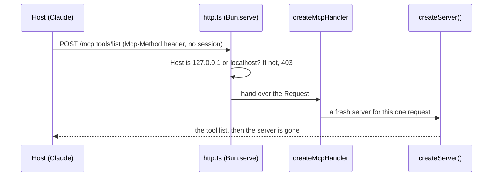

# Serve over HTTP

## The problem

Your server talks over stdio. A stdio server runs on one laptop, for one host. Harrow Lane has three sites and
twelve staff, so the server needs a web address that every desk can reach.

There are two traps on the way:

- Older hosts still open with `initialize`. The 2026-07-28 spec has no `initialize` and no sessions. Your server
  must serve both kinds, or some desks break.
- A web page on another site can make a browser send requests to `127.0.0.1`. This trick is called DNS rebinding.
  The SDK does not stop it for you. You check the `Host` header yourself.



## Your challenge

`server.ts` is ready. It has every clinic tool. Finish `http.ts`:

1. Make one handler: `createMcpHandler(() => createServer())`.
2. In `handleRequest`, return `hostHeaderValidationResponse(request, localhostAllowedHostnames())` when it is not
   undefined. That is the 403 for a strange `Host`.
3. Answer 404 for any path but `/mcp`. Hand every other request to `mcpHandler.fetch(request)`.

Start it in one terminal:

```bash
cd parts/03-open-the-server-safely/01-serve-over-http/problem && bun http.ts
```

Expect: `harrow-lane server listening on http://127.0.0.1:8787/mcp`. Press Ctrl+C to stop it.

For example, with the server running, ask for the tool list with plain `curl`. There is no `initialize` first:

```bash
curl -s -X POST http://127.0.0.1:8787/mcp -H 'content-type: application/json' -H 'accept: application/json, text/event-stream' -H 'mcp-method: tools/list' -H 'mcp-protocol-version: 2026-07-28' -d '{"jsonrpc":"2.0","id":1,"method":"tools/list","params":{"_meta":{"io.modelcontextprotocol/protocolVersion":"2026-07-28","io.modelcontextprotocol/clientCapabilities":{}}}}'
```

Expect: one JSON line that starts `{"result":{"tools":[{"name":"find_patient"`. The starter prints
a TODO line instead.

If you already know this: `createMcpHandler` serves older clients by default (`legacy: 'stateless'`). Each
legacy request gets a fresh server too, so `GET` and `DELETE` answer 405.

## Done when

- `bun http.ts` starts and answers on the port in `MCP_PORT`.
- A `tools/list` request with no `initialize` and no session id lists the clinic tools.
- A request with the header `Host: evil.example` gets 403.
- An older client that starts with `initialize` is still served.
- The MCP client calls `find_free_slots` over HTTP and gets the free times in the diary.

```bash
bun run verify serve-over-http
```

Expect: `Done. All 5 rules pass.` once your work meets every Done when line. Before that, each FAIL line has a `Try next:`.

## If you get stuck

- The check starts `bun http.ts` itself, on a free port, with a fresh copy of the diary. Stop your own server first
  if you want, but it does not get in the way.
- Read the port from `process.env.MCP_PORT`. A fixed 8787 fails the check.
- The solution is there after you try: `../solution/http.ts`.

## Words you will use

- **Streamable HTTP**: the way MCP works over the web. The client POSTs one JSON-RPC message to one URL.
- **Stateless**: the server keeps nothing between requests. Every request carries all it needs in `_meta`.
- **Era**: which spec a client speaks. Modern is 2026-07-28. Legacy is 2025-11-25 and older, with `initialize`.
- **DNS rebinding**: a trick that makes a browser send a page's requests to a server on your own computer.
- **Host header**: the name of the server the request is for, such as `127.0.0.1:8787`.
