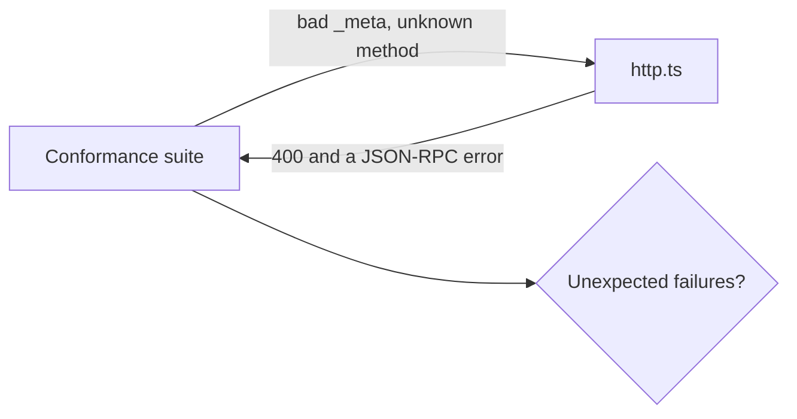

# Pass conformance

## The problem

Your server works with the course client, which does not prove it works with every host. The MCP project ships a strict test client, the conformance suite, with over a hundred checks. For example, Kofi hid the dashboard's 400 and 404 noise by answering 200 to every bad request. The dashboard is quiet. The server is now wrong.



## Watch it done

```bash
bun run verify pass-conformance
```

Expect: `FAIL  Every server-stateless check the course does not excuse passes` and `2 of 4 rules pass.`

```bash
bun run verify pass-conformance solution
```

Expect: `Done. All 4 rules pass.`


## Your turn

1. Start the server in one terminal.

```bash
cd parts/03-open-the-server-safely/02-pass-conformance/problem && bun http.ts
```

Expect: `harrow-lane server listening on http://127.0.0.1:8787/mcp`.

2. In a second terminal, from the repo root, run the suite.

```bash
bunx @modelcontextprotocol/conformance@0.2.0-alpha.12 server --url http://127.0.0.1:8787/mcp --requirements 2026-07-28 --expected-failures parts/03-open-the-server-safely/conformance-expected-failures.yml
```

Expect: a red `Unexpected failures` list that starts with `server-stateless:sep-2575-request-meta-invalid`.

3. Fix `http.ts` so a bad request keeps its real 400 status. Return the handler's `Response` as it is. Run the suite again.

Expect: the run ends with the baseline check passed.

Never add a line to `conformance-expected-failures.yml` to make your server pass.

## Do it on your work

Run the suite against your own server. For each failure, change the server, never the list. Good looks like exit code 0 with every excused scenario explained.

## Done when

- `bun http.ts` answers on the port in `MCP_PORT`.
- Every `server-stateless` check the course does not excuse passes.
- The `dns-rebinding-protection` scenario passes.
- The whole suite exits 0 with the shipped expected-failures file.

```bash
bun run verify pass-conformance
```

Expect: `Done. All 4 rules pass.` The first run downloads the suite, so it needs the internet once.

## Solution

The after state keeps each status as the handler sent it. See `solution/http.ts`.

## Go further

The expected-failures file excuses scenarios that need the suite's own test tools, and prompts and resources this server does not offer. Read its comments. The `--requirements` flag pins the scenarios to one spec, so a newer suite cannot fail you on a rule that did not exist then.

## If you get stuck

- An HTTP status is part of the protocol. A dashboard should count real errors, not change them.

## Words you will use

- **Conformance suite**: the official tests for MCP. Every server that follows the spec should pass them.
- **Scenario**: one group of checks in the suite, such as `server-stateless`.
- **Expected failure**: a scenario the course excuses, with the reason written next to it.
