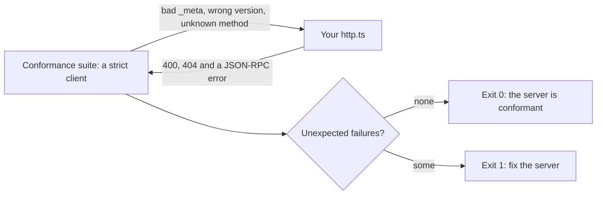
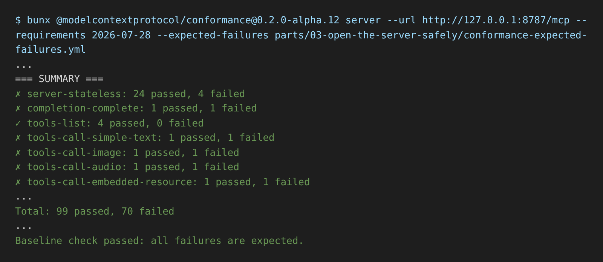

# Pass conformance

## The problem

Your server works with the course client. That does not prove it works with every host. Claude, an IDE and a
partner's agent each read the spec a little differently. The MCP project ships an official test suite for this:
the conformance suite. It acts as a strict client and runs more than a hundred checks against your server.

Kofi looks after the clinic's monitoring. The error dashboard showed many 400 and 404 answers from the MCP
server, so he changed `http.ts`. Now every failed request answers 200 with a friendly message. The dashboard is
quiet. Is the server still correct?



## Your challenge

1. Start the server in one terminal:

```bash
cd parts/03-open-the-server-safely/02-pass-conformance/problem && bun http.ts
```

Expect: `harrow-lane server listening on http://127.0.0.1:8787/mcp`.

2. In a second terminal, from the repo root, run the suite against it:

```bash
bunx @modelcontextprotocol/conformance@0.2.0-alpha.12 server --url http://127.0.0.1:8787/mcp --requirements 2026-07-28 --expected-failures parts/03-open-the-server-safely/conformance-expected-failures.yml
```

Expect: a summary, then a red `Unexpected failures` list that starts with `server-stateless:sep-2575-request-meta-invalid`.

3. Read the list. Then fix `http.ts` so the suite ends with `Baseline check passed`.

For example, one check sends a request with no `_meta`. The spec says the answer is HTTP 400 with a JSON-RPC
error. Kofi's change turns that 400 into a 200. A client can then no longer tell a bad request from a good one.

The file `conformance-expected-failures.yml` excuses scenarios that need the suite's own test tools, such as
`test_simple_text`. It also excuses prompts and resources, which this server does not offer. Read its comments.
Never add a line to it to make your server pass.

If you already know this: `--requirements 2026-07-28` runs the scenarios frozen when that spec shipped. So a newer
suite release cannot fail you on a rule that did not exist then.



## Done when

- `bun http.ts` starts and answers on the port in `MCP_PORT`.
- Every `server-stateless` check the course does not excuse passes.
- The `dns-rebinding-protection` scenario passes.
- The whole suite exits 0 with the shipped expected-failures file.

```bash
bun run verify pass-conformance
```

Expect: `Done. All 4 rules pass.` once your work meets every Done when line. Before that, each FAIL line has a `Try next:`.

## If you get stuck

- The first run downloads the suite, so it needs the internet once.
- An HTTP status is part of the protocol. A dashboard should count real errors, not change them.
- The solution is there after you try: `../solution/http.ts`.

## Words you will use

- **Conformance suite**: the official tests for MCP. Every server that follows the spec should pass them.
- **Scenario**: one group of checks in the suite, such as `server-stateless` or `tools-list`.
- **Expected failure**: a scenario the course excuses, with the reason written next to it.
- **Baseline**: the list of expected failures. A new failure that is not on it fails the run.
