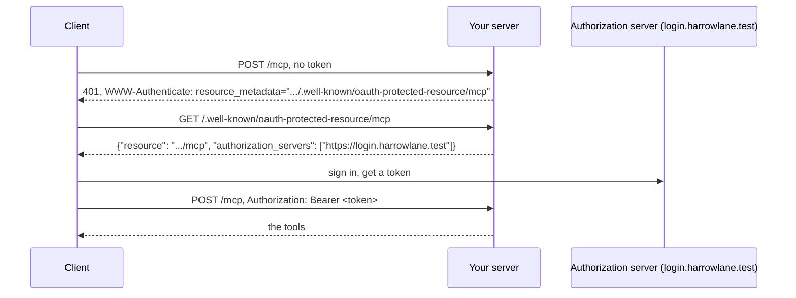

# Require a token

## The problem

Your server now has a URL, and it answers anyone who finds it. A request with no sign-in can still list
patients and book appointments. Every request needs to say who is asking, with a token.

A token is a signed note from the clinic's authorization server: "this is Ola, a Millbrook receptionist, until
16:00". MCP uses OAuth for this. Your server is the resource server. It never signs anyone in. It reads the token,
checks it, and says no when the token is missing or wrong.

A client with no token also needs to learn where to sign in. Your 401 answer tells it, through a small public
JSON file called the protected resource metadata.



## Your challenge

Change `http.ts`. The TODO lines show where.

1. Import `ISSUER`, `RESOURCE` and `readToken` from `"../../clinic-login"`.
2. Serve the metadata: `oauthMetadataResponse(request, { oauthMetadata, resourceServerUrl })`. Put it before the
   path check, because it is not on `/mcp`.
3. Build `checkBearerToken` with `requireBearerAuth({ verifier, resourceMetadataUrl })`. The verifier's
   `verifyAccessToken(token)` calls `readToken(token)` and returns an `AuthInfo`. On an error it throws
   `new OAuthError(OAuthErrorCode.InvalidToken, ...)`.
4. When `checkBearerToken(request)` gives back a `Response`, return it. Otherwise call
   `mcpHandler.fetch(request, { authInfo })`.

For example, here is what the sample solution answers to a request with no token:

```bash
curl -s -i -X POST http://127.0.0.1:8787/mcp -d '{}'
```

Expect: `HTTP/1.1 401 Unauthorized` and a header `WWW-Authenticate: Bearer error="invalid_token", error_description="Missing Authorization header", resource_metadata="http://127.0.0.1:8787/.well-known/oauth-protected-resource/mcp"`.

To try a real token, run `bun run finished` once and copy Ola's token. Stop it, start your server, and send
the token in the header `Authorization: Bearer <token>`.

If you already know this: `requireBearerAuth` reads only the `Authorization` header. That is the spec's rule, so a
token never sits in a URL, a log or a browser history.

## Done when

- `bun http.ts` starts and answers on the port in `MCP_PORT`.
- A request with no token gets 401 and a `WWW-Authenticate` header that names the metadata URL.
- The protected resource metadata names this server and the clinic's authorization server.
- Ola's real token in the `Authorization` header lists the tools.
- A token in the URL query string is refused with 401.
- A token signed with another key is refused with 401.

```bash
bun run verify require-a-token
```

Expect: `Done. All 6 rules pass.` once your work meets every Done when line. Before that, each FAIL line has a `Try next:`.

## If you get stuck

- `readToken` checks the signature, the issuer and the expiry. It does not check the audience yet. That is the
  next step.
- `oauthMetadataResponse` returns undefined for any other path, so it is safe to call first.
- The solution is there after you try: `../solution/http.ts`.

## Words you will use

- **Token**: a signed piece of text that says who the caller is and what they may do.
- **Resource server**: a server that accepts tokens but never hands them out. Your MCP server is one.
- **Authorization server**: the server that signs people in and signs their tokens.
- **Protected resource metadata**: a public JSON file that tells a client which authorization server to use.
- **401**: the HTTP answer for "you are not signed in, or your token is not valid".
