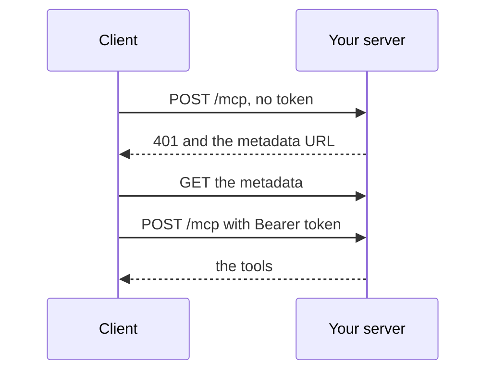

# Require a token

## The problem

Your server has a URL and answers anyone who finds it. For example, a request with no sign-in can still list patients and book appointments. A token fixes that. It is a signed note from the clinic's login service that says who is asking, such as Ola, a Millbrook receptionist. Your server only reads and checks it.



## Watch it done

```bash
bun run verify require-a-token
```

Expect: `FAIL  A request with no token gets 401 and a WWW-Authenticate header that names the metadata URL` and `2 of 6 rules pass.`

```bash
bun run verify require-a-token solution
```

Expect: `Done. All 6 rules pass.`

## Your turn

Change `http.ts`. The TODO lines show where.

1. Serve the metadata with `oauthMetadataResponse`, before the path check.
2. Build `checkBearerToken` with `requireBearerAuth`. Its verifier calls `readToken` from `"../../clinic-login"`.
3. When `checkBearerToken` gives back a `Response`, return it. That is the 401.
4. Otherwise call `mcpHandler.fetch(request, { authInfo })`.
5. Start the server.

```bash
cd parts/03-open-the-server-safely/03-require-a-token/problem && bun http.ts
```

Expect: `harrow-lane server listening on http://127.0.0.1:8787/mcp`.

6. From a second terminal, send a request with no token.

```bash
curl -s -i -X POST http://127.0.0.1:8787/mcp -d '{}'
```

Expect: `HTTP/1.1 401 Unauthorized` and a `WWW-Authenticate` header that ends with `resource_metadata="http://127.0.0.1:8787/.well-known/oauth-protected-resource/mcp"`. The starter answers 415, because it checks no token.

## Do it on your work

Put the same check in front of your own server. Run `bun run finished` once to copy Ola's token, then send it as `Bearer <token>`. Good looks like 401 with no token and a tool list with Ola's.

## Done when

- A request with no token gets 401 and a header that names the metadata URL.
- The metadata names this server and the clinic's login server.
- Ola's real token lists the tools.
- A token in the URL query string gets 401.
- A token signed with another key gets 401.

```bash
bun run verify require-a-token
```

Expect: `Done. All 6 rules pass.`

## Solution

The after state serves the metadata and checks the token. See `solution/http.ts`.

## Go further

`requireBearerAuth` reads only the `Authorization` header, so a token never lands in a URL or a log. `readToken` checks the signature, issuer and expiry, but not the audience yet. That is the next step.

## If you get stuck

- `oauthMetadataResponse` returns undefined for any other path, so it is safe to call first.

## Words you will use

- **Token**: a signed piece of text that says who the caller is and what they may do.
- **Resource server**: a server that accepts tokens but never hands them out. Your MCP server is one.
- **Authorization server**: the server that signs people in and signs their tokens.
- **Protected resource metadata**: a public JSON file that tells a client which authorization server to use.
- **401**: the HTTP answer for "you are not signed in, or your token is not valid".
