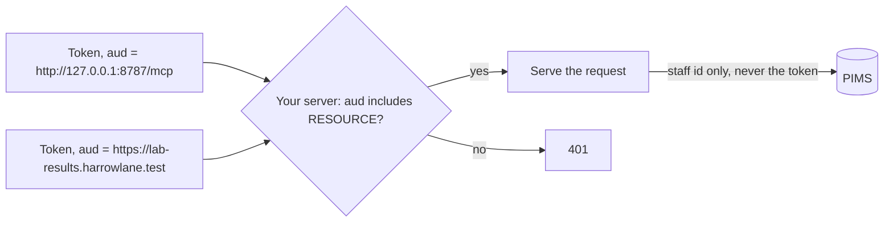

# Check the audience

## The problem

The clinic signs tokens for more than one server. Next year a lab-results server joins, with its own tokens from
the same authorization server. Your server checks the signature and the expiry. So a token made for the lab
server passes your check too.

That is a confused deputy. A server that accepts any good-looking token can be used by anyone who holds a token
for something else. The MCP spec says a server MUST refuse a token that was not made for it.

The same rule works the other way. Your server must never send the caller's token on to another system. That
is called token passthrough, and the spec forbids it as well.



## Your challenge

Change `verifyAccessToken` in `http.ts`:

1. Read `claims.aud`. It holds one URL or a list of URLs.
2. Turn it into a list with `[claims.aud].flat()`.
3. When the list does not include `RESOURCE`, throw an error. The SDK turns it into a 401.

Then read every place where `server.ts` calls the PIMS. Make sure no tool sends `authInfo.token` with it.

For example, the sample solution refuses a lab-results token for Ola like this:

```text
HTTP/1.1 401 Unauthorized
WWW-Authenticate: Bearer error="invalid_token", error_description="token rejected: the token is for
  https://lab-results.harrowlane.test, not for http://127.0.0.1:8787/mcp", resource_metadata="..."
```

The check also calls `find_patient` as Ola, then reads the world log. Every PIMS call is one line there, such as
`{"fn":"findPatients","args":{"name":"Biscuit"},"rows":1}`. No part of Ola's token may appear in it.

If you already know this: the SDK can do the same check. Give `requireBearerAuth` an `expectedResource`, and set
`resource` in the `AuthInfo` from the token's audience.

## Done when

- `bun http.ts` starts and Ola's token for this server still lists the tools.
- A token made for the lab-results server gets 401.
- An expired token gets 401.
- The caller's token never reaches the PIMS.

```bash
bun run verify check-the-audience
```

Expect: `Done. All 4 rules pass.` once your work meets every Done when line. Before that, each FAIL line has a `Try next:`.

## If you get stuck

- `RESOURCE` comes from `"../../clinic-login"`. It follows `MCP_PORT`, so it is right on the check's port too.
- Compare the whole URL. A check for "has an audience" or "starts with http" lets the lab token in.
- The solution is there after you try: `../solution/http.ts`.

## Words you will use

- **Audience (`aud`)**: the claim in a token that names the server it was made for.
- **Confused deputy**: a server tricked into using its power for someone who should not have it.
- **Token passthrough**: a server that sends the caller's token on to another system. Never do it.
- **Claim**: one fact inside a token, such as `sub` (who), `scope` (what they may do) or `exp` (when it ends).
