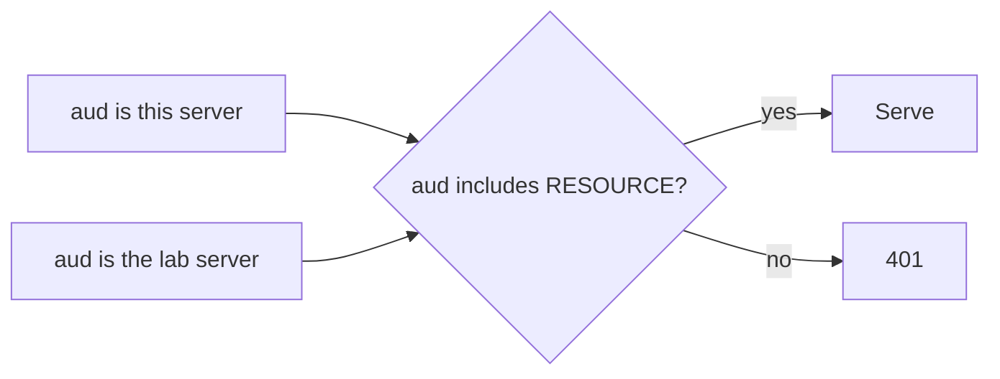

# Check the audience

## The problem

The clinic signs tokens for more than one server. For example, a lab-results server will get its own tokens from the same login service. Your server checks the signature and expiry, so a lab token passes too. The audience is the claim that names the server a token was made for. The spec says to refuse any other.



## Watch it done

```bash
bun run verify check-the-audience
```

Expect: `FAIL  A token made for the lab-results server gets 401` and `3 of 4 rules pass.`

```bash
bun run verify check-the-audience solution
```

Expect: `Done. All 4 rules pass.`

## Your turn

Change `verifyAccessToken` in `http.ts`.

1. Read `claims.aud`. It holds one URL or a list.
2. Turn it into a list with `[claims.aud].flat()`.
3. When the list does not include `RESOURCE`, throw an error. The SDK turns it into a 401.
4. Read each place `server.ts` calls the practice system. No tool may send `authInfo.token` with it. That is token passthrough, and the spec forbids it.
5. Run the check.

```bash
bun run verify check-the-audience
```

Expect: `Done. All 4 rules pass.` The check calls `find_patient` as Ola, then reads the world log, where no part of her token may appear.

## Do it on your work

Find where your server learns the token's audience. Compare the whole URL, never only "has an audience". Good looks like 401 for a token made for any other server.

## Done when

- Ola's token for this server still lists the tools.
- A token made for the lab-results server gets 401.
- An expired token gets 401.
- The caller's token never reaches the practice system.

## Solution

The after state refuses a token for another server. See `solution/http.ts`.

## Go further

The SDK can do the same check. Give `requireBearerAuth` an `expectedResource`, and set `resource` in the `AuthInfo` from the token's audience.

## If you get stuck

- `RESOURCE` comes from `"../../clinic-login"`. It follows `MCP_PORT`, so it is right on the check's port too.
- A test for "starts with http" lets the lab token in.

## Words you will use

- **Audience (`aud`)**: the claim in a token that names the server it was made for.
- **Confused deputy**: a server tricked into using its power for someone who should not have it.
- **Token passthrough**: a server that sends the caller's token on to another system. Never do it.
