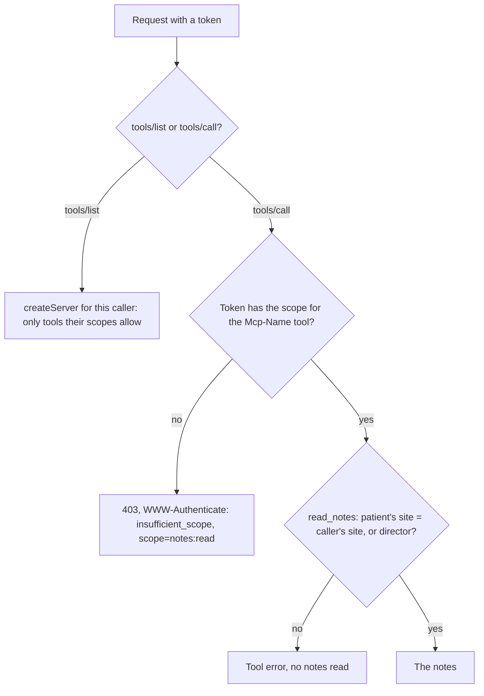
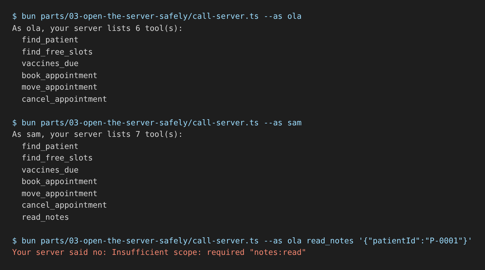

# Limit by role

## The problem

Every signed-in person now sees every tool. Ola is a receptionist. She books and moves appointments. She should
never read a dog's clinical notes or the controlled-drugs register. A vet reads notes, but only for patients of
their own site. Only Joon, the clinical director, reads the drugs register.

Each token carries scopes, the kinds of data it may touch. The clinic uses four:

| Role         | Scopes                                         |
| ------------ | ---------------------------------------------- |
| receptionist | `diary:read diary:write`                       |
| vet, nurse   | `diary:read diary:write notes:read`            |
| director     | `diary:read diary:write notes:read drugs:read` |

Hiding a tool is the first wall. The second wall is a clear 403 when someone calls it anyway. The 403 names the
scope, so a client can ask the person to sign in with more access. This is called step-up.



## Your challenge

`server.ts` already has `Caller`, `callerFrom` and the `TOOL_SCOPES` table. Follow the four TODO lines:

1. In `createServer(caller)`, register a tool only when the caller's scopes include its scope.
2. In `readNotes`, refuse a patient from another site, unless the caller is the director.
3. In `http.ts`, build each server with `createServer(callerFrom(authInfo))`.
4. In `http.ts`, answer a `tools/call` for a tool the token may not use with a 403 that names the scope.

Then try it with your server running:

```bash
bun parts/03-open-the-server-safely/call-server.ts --as ola
```

Expect: `As ola, your server lists 6 tool(s):` and no `read_notes` in the list.

For example, the sample solution answers Dr Reyes like this when she asks for Bear, a Harrow Lane cat:

```text
Tool error from read_notes:
Bear is a harrow-lane patient. You can read notes for millbrook patients only.
```



If you already know this: the SDK can also run a `scopeChallenge` per tool, but only for tools that are registered.
Here the tool is hidden, so the 403 comes from `http.ts`.

## Done when

- Ola's `tools/list` has the diary tools but no `read_notes` and no `controlled_drugs_log`.
- Ola's direct call to `read_notes` gets 403 with `scope="notes:read"`, and no notes are read.
- Dr Reyes reads the notes of Biscuit, a Millbrook patient.
- Dr Reyes cannot read the notes of Bear, a Harrow Lane patient.
- Dr Reyes gets 403 on `controlled_drugs_log`, and Joon the director reads it.

```bash
bun run verify limit-by-role
```

Expect: `Done. All 5 rules pass.` once your work meets every Done when line. Before that, each FAIL line has a `Try next:`.

## If you get stuck

- The scope says what kind of data. The site rule is about which records. You need both checks.
- Check the site before you call `clinic.clinicalNotes`. The check reads the world log to see what was read.
- The solution is there after you try: `../solution/server.ts` and `../solution/http.ts`.

## Words you will use

- **Scope**: one kind of access a token carries, such as `notes:read`.
- **Least privilege**: give each person only the access their job needs.
- **403**: the HTTP answer for "you are signed in, but not allowed to do this".
- **Step-up**: a 403 that names the missing scope, so the person can sign in again with more access.
