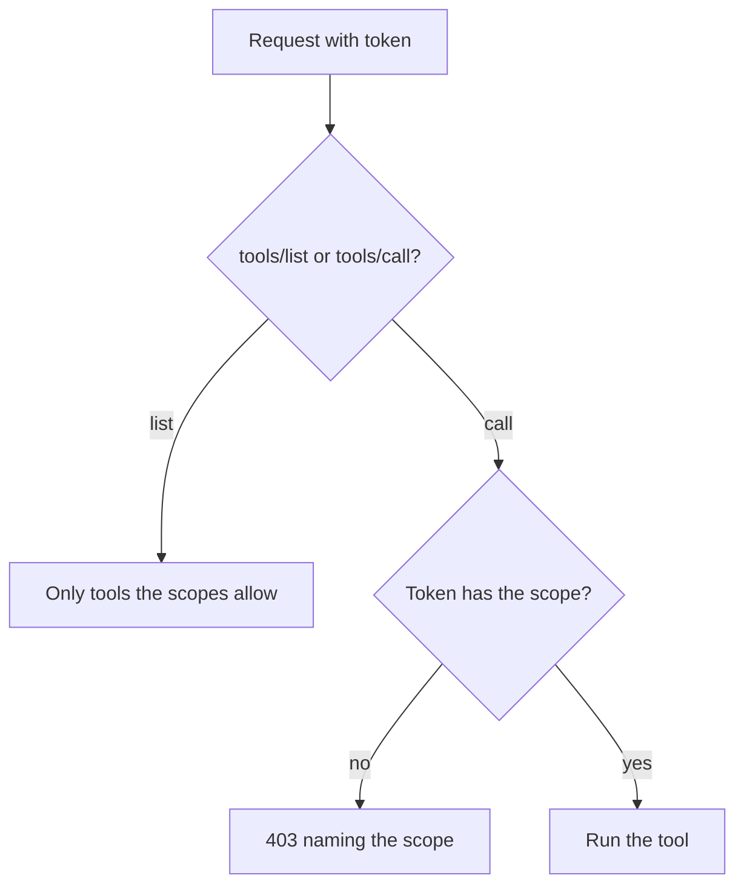

# Limit by role

## The problem

Every signed-in person sees every tool. For example, Ola the receptionist should never read a dog's clinical notes. A vet reads notes only for their own site, and only Joon, the director, reads the controlled-drugs register. Each token carries scopes, the kinds of data it may touch.



## Watch it done

```bash
bun run verify limit-by-role
```

Expect: `FAIL  Ola's tools/list has the diary tools but no read_notes and no controlled_drugs_log` and `1 of 5 rules pass.`

```bash
bun run verify limit-by-role solution
```

Expect: `Done. All 5 rules pass.`


## Your turn

`server.ts` has `Caller`, `callerFrom` and the `TOOL_SCOPES` table. Follow the four TODO lines.

1. In `createServer(caller)`, register a tool only when the caller's scopes include its scope.
2. In `readNotes`, refuse a patient from another site, unless the caller is the director.
3. In `http.ts`, build each server with `createServer(callerFrom(authInfo))`.
4. In `http.ts`, answer a `tools/call` for a tool the token may not use with a 403 that names the scope.
5. Start your server, then ask as Ola.

```bash
bun parts/03-open-the-server-safely/call-server.ts --as ola
```

Expect: `As ola, your server lists 6 tool(s):` and no `read_notes` in the list.

## Do it on your work

Write a table of roles and scopes for your own tools. Hide what a role cannot use, and still refuse a direct call. Good looks like a 403 that names the missing scope.

## Done when

- Ola's tool list has no `read_notes` and no `controlled_drugs_log`.
- Ola's direct call to `read_notes` gets 403 with `scope="notes:read"`.
- Dr Reyes reads Biscuit's notes, a Millbrook patient, but not Bear's, a Harrow Lane patient.
- Dr Reyes gets 403 on `controlled_drugs_log`, and Joon reads it.

```bash
bun run verify limit-by-role
```

Expect: `Done. All 5 rules pass.`

## Solution

The after state hides tools by scope and checks the site. See `solution/server.ts` and `solution/http.ts`.

## Go further

A 403 that names the missing scope is called step-up, so the client can ask the person to sign in again with more access. An SDK scope challenge runs only for registered tools, so a hidden tool needs the check in `http.ts`.

## If you get stuck

- Check the site before you call `clinic.clinicalNotes`. The check reads the world log to see what was read.

## Words you will use

- **Scope**: one kind of access a token carries, such as `notes:read`.
- **Least privilege**: give each person only the access their job needs.
- **403**: the HTTP answer for "you are signed in, but not allowed to do this".
