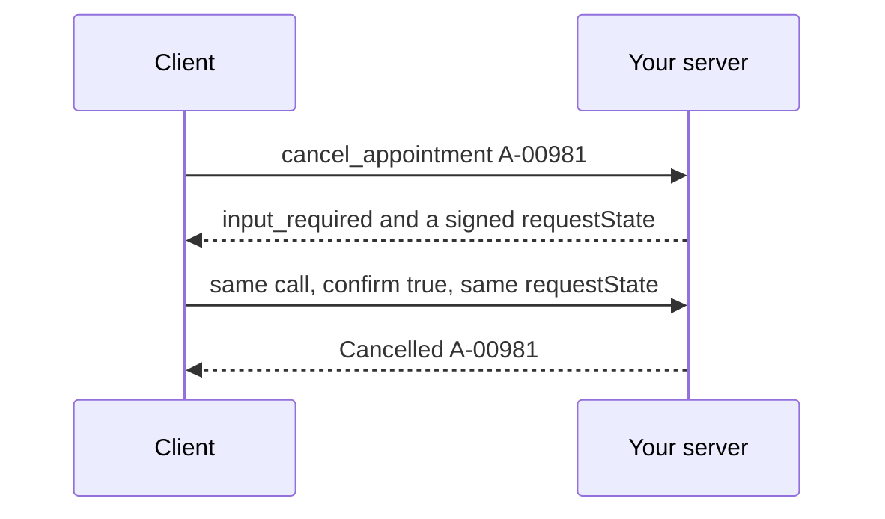

# Confirm before cancel

## The problem

`cancel_appointment` cancels at once. For example, a model that reads "can we move Biscuit?" as "cancel Biscuit" frees the slot, and the owner finds out at the door. So a person says yes first. The server asks, the client shows a dialog, and the same call comes back with the answer.



## Watch it done

```bash
bun run verify confirm-before-cancel
```

Expect: `FAIL  The first call asks the person, names Biscuit and 15:40, and changes nothing` and `1 of 7 rules pass.`

```bash
bun run verify confirm-before-cancel solution
```

Expect: `Done. All 7 rules pass.`


## Your turn

Follow the three TODO lines in `server.ts`.

1. On the first call, return `inputRequired(...)` with an `elicit` question that names the patient, time and vet.
2. Sign the state with `createRequestStateCodec`, and give `new McpServer` its `verify`. The client holds the state, so it must be signed.
3. On the retry, cancel only on a yes whose signed state names this same appointment.
4. Try it. The helper answers no unless you add `--confirm yes`.

```bash
bun parts/03-open-the-server-safely/call-server.ts --as ola cancel_appointment '{"appointmentId":"A-00981"}'
```

Expect: `Cancel Biscuit, 15:40 on 2026-11-16 with Dr Sam Reyes?  (answering no)` then `Kept A-00981. Nothing changed.`

The starter really cancels the appointment. Run `bun run world reset` to get it back.

## Do it on your work

Pick your most harmful tool. Make it ask first, and sign what it asked about. Good looks like no change on a no, a faked yes, or a yes for another record.

## Done when

- The first call asks, names Biscuit and 15:40, and changes nothing.
- A no keeps the appointment.
- A yes with no `requestState`, or a tampered one, changes nothing.
- A yes with the state of another appointment changes nothing.
- A yes with its own signed state cancels it.

```bash
bun run verify confirm-before-cancel
```

Expect: `Done. All 7 rules pass.`

## Solution

The after state asks, signs, and cancels only on a matching yes. See `solution/server.ts`.

## Go further

The middle of the signed state is plain base64 that anyone can read. The signature stops changes. The codec also takes a `bind` function. Bind the state to the caller's staff id. Then a state minted for Ola fails for anyone else.

## If you get stuck

- `context.mcpReq.requestState()` gives the payload you minted. It is undefined on the first call.
- `verify` refuses a tampered state with error -32602 before your tool runs.

## Words you will use

- **Elicitation**: the server asks the person a question through the client.
- **`input_required`**: a result that says "I need an answer first".
- **`requestState`**: a note the server hands to the client and gets back on the retry.
