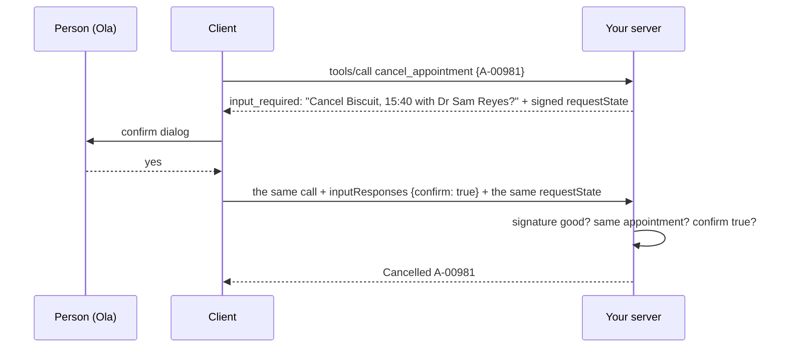
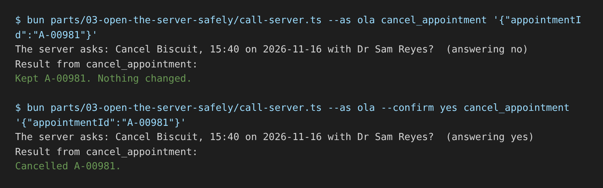

# Confirm before cancel

## The problem

`cancel_appointment` cancels at once. A model that misreads "can we move Biscuit?" as "cancel Biscuit" frees the
slot, and the owner finds out at the door. A cancel cannot be undone by the model, so a person says yes first.

The 2026-07-28 spec does this with one request in two rounds. The first answer is not a result. It is
`input_required`: a question for the person. The client shows a confirm dialog, then sends the same call again
with the answer.

There is a trap. The client sends the answer, so a client can also invent it. It could send "yes" on the very
first call. So your question carries a `requestState`: a small note, signed by your server, that says which
appointment you asked about. You trust a yes only when your own signed note comes back with it.



## Your challenge

Follow the three TODO lines in `server.ts`:

1. On the first call, return `inputRequired(...)` with an `elicit` question. It names the patient, time and vet.
2. Sign the state with `createRequestStateCodec`. Give `new McpServer` its `verify`.
3. On the retry, cancel only on a yes whose signed state names this same appointment.

Try it with your server running. The helper answers no unless you add `--confirm yes`:

```bash
bun parts/03-open-the-server-safely/call-server.ts --as ola cancel_appointment '{"appointmentId":"A-00981"}'
```

Expect: `The server asks: Cancel Biscuit, 15:40 on 2026-11-16 with Dr Sam Reyes?  (answering no)` and then `Kept A-00981. Nothing changed.`

For example, the sample solution's first answer, cut short:

```text
{"resultType":"input_required","inputRequests":{"confirm":{"method":"elicitation/create",
 "params":{"message":"Cancel Biscuit, 15:40 on 2026-11-16 with Dr Sam Reyes?", ...}}},
 "requestState":"v1.eyJwIjp7ImFwcG9pbnRtZW50SWQiOiJBLTAwOTgxIn0sImV4cCI6MTc5NDU0NjI3N30.5gtnWZLI..."}
```

The middle part is plain base64 that anyone can read. The last part is the signature, so nobody can change it.



If you already know this: the codec also takes a `bind` function. Bind the state to the caller's staff id, so a
state minted for Ola is refused for anyone else.

## Done when

- The first call asks the person, names Biscuit and 15:40, and changes nothing.
- An answer of no keeps the appointment.
- A yes that skips the question, with no `requestState`, changes nothing.
- A yes with a tampered `requestState` changes nothing.
- A yes that carries the state of another appointment changes nothing.
- A yes with its own signed state cancels the appointment.
- The real MCP client confirms and the appointment is cancelled.

```bash
bun run verify confirm-before-cancel
```

Expect: `Done. All 7 rules pass.` once your work meets every Done when line. Before that, each FAIL line has a `Try next:`.

## If you get stuck

- `context.mcpReq.requestState()` gives the payload you minted. It is undefined on the first call.
- `verify` refuses a tampered state with error `-32602` before your tool runs.
- The solution is there after you try: `../solution/server.ts`.

## Words you will use

- **Elicitation**: the server asks the person a question through the client.
- **`input_required`**: a result that says "I need an answer before I can finish".
- **`requestState`**: a note the server hands to the client and gets back on the retry. Sign it, because the
  client holds it.
