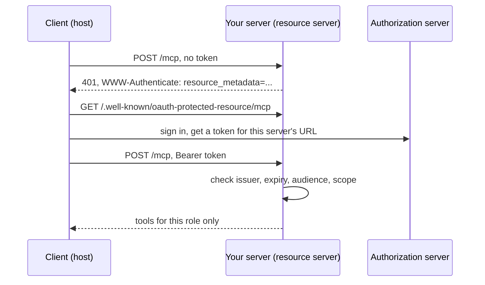

# Open the server safely

## The problem

Three sites and twelve staff cannot share a stdio server on one laptop. The server has to go remote. Once it has a
URL, anyone who finds it can try it, and one missing check leaks owners' phone numbers or a dog's clinical notes to
the wrong desk. In this part you serve the current spec over Streamable HTTP, pass the official conformance suite,
require a token, check its audience, limit each role, and make cancelling an appointment wait for a person's yes.

## Why it matters

Remote MCP adds an OAuth flow, and every field in it is input from someone else. The `mcp-remote` package let a
malicious server run commands on the client's machine through a crafted `authorization_endpoint` URL: CVE-2025-6514,
rated critical with a CVSS score of 9.6, affecting versions 0.0.5 up to 0.1.16
([GitHub advisory GHSA-6xpm-ggf7-wc3p](https://github.com/advisories/GHSA-6xpm-ggf7-wc3p)). The spec's own security
guide forbids token passthrough: a server must reject tokens that were not issued for it
([Security Best Practices](https://github.com/modelcontextprotocol/modelcontextprotocol/blob/main/docs/docs/2026-07-28/tutorials/security/security_best_practices.mdx)).



## Steps

| Step | Minutes | You produce | The check reads |
|---|---|---|---|
| `serve-over-http` | 15 | `createMcpHandler` served by Bun on `127.0.0.1:8787/mcp`, with a Host check | a stateless `tools/list` with no session, 403 for `Host: evil.example`, a legacy-era client still served |
| `pass-conformance` | 10 | nothing new unless it fails | `@modelcontextprotocol/conformance` exit code against the server, with a shipped expected-failures file (pin the exact version at build) |
| `require-a-token` | 15 | `requireBearerAuth` and protected resource metadata | 401 with `WWW-Authenticate` naming the metadata URL; the metadata JSON; a token in the query string refused |
| `check-the-audience` | 10 | token checks for issuer, expiry and audience; no passthrough to the PIMS | tokens minted for another server and expired tokens get 401; the world log shows no inbound token sent on |
| `limit-by-role` | 10 | scopes `diary:read`, `diary:write`, `notes:read`, `drugs:read`, with tools hidden or refused by scope | Ola's token lists no notes tool and gets 403 on a direct call; Dr Reyes reads notes for her site only; only Joon reads the drugs log |
| `confirm-before-cancel` | 10 | `cancel_appointment` that returns `input_required` and cancels only on a yes | the diary row after a first call, a retry with no, a retry with yes, and a tampered `requestState` |

Total: 70 minutes. The finished server in `world/finished/` already does all six; tokens come from `world/auth.ts`.

## Walkthrough

TODO(part session): one `bun run verify <step-name>` per step, each with its `Expect:` line.

```bash
bun run verify part open-the-server-safely
```

Expect: `Part open-the-server-safely is done: 6/6 steps pass.` once the part session has built the steps.
